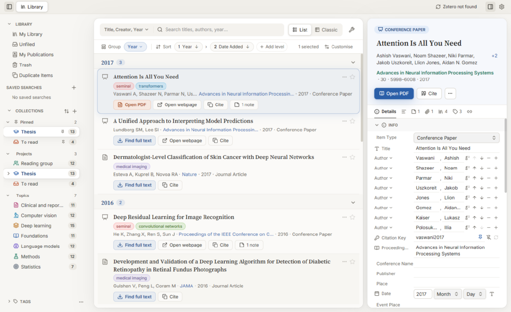
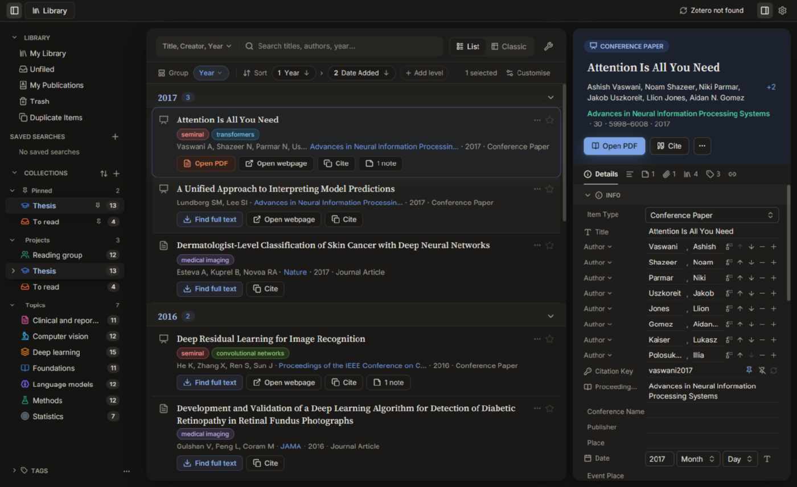
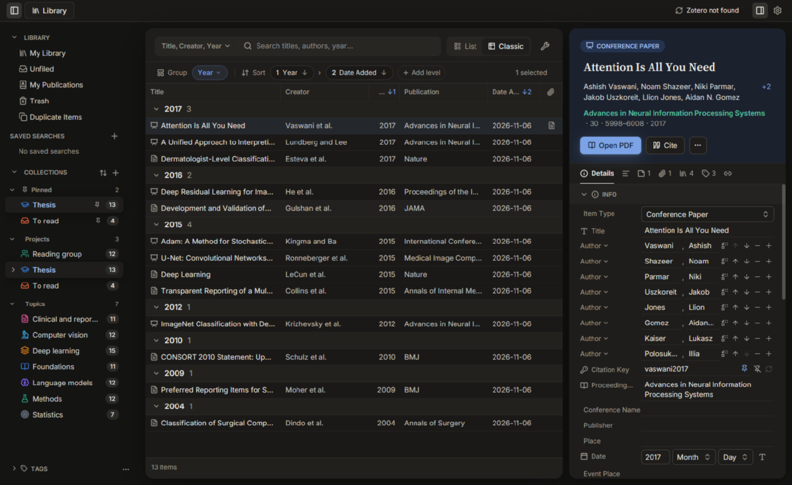
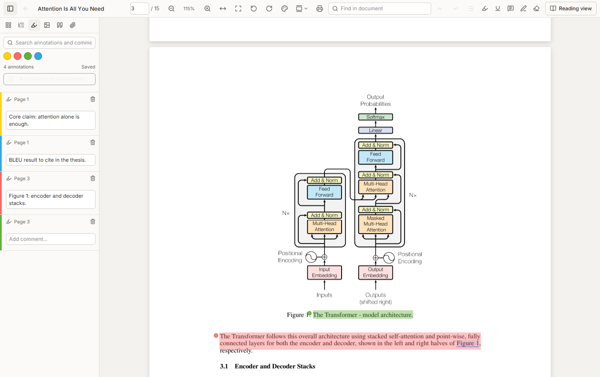
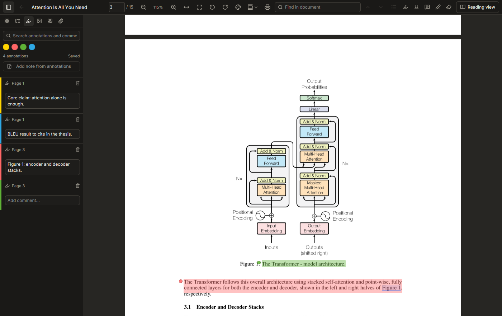
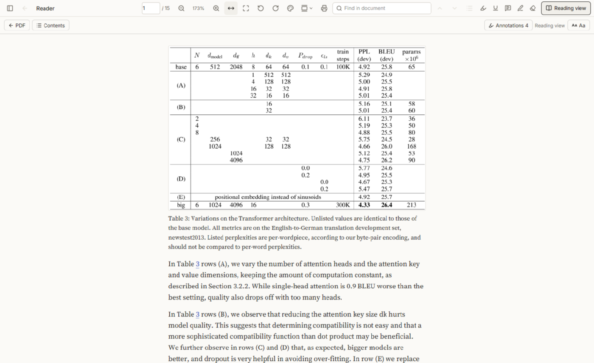
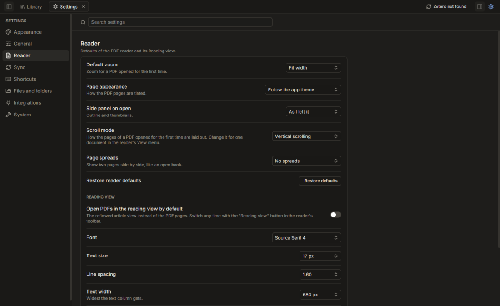

# Zotero Next

**A fast, modern reference manager for Windows that works with your Zotero library.** It opens in half a second, searches a 12,000-item library in tens of milliseconds, uses less than half of Zotero's working memory, and keeps saving references and inserting Word citations when the app is closed. It reads and syncs your Zotero data, runs Zotero's own translators, and has a built-in MCP server for AI agents.

[](https://github.com/ABorakati/zotero-next/actions/workflows/ci.yml)
<!-- The CI badge above only renders for people who have access to this private repository. The badges below are static, so they work for everyone. -->




Everything in the screenshots on this page comes from a demo library of well-known public papers, made only for these pictures.

## Why Zotero Next

Zotero Next opens the same kind of library as Zotero and speaks the same connector protocol. What differs is the engine underneath. The numbers below compare it with an installed **Zotero 10.0.7** on one Windows 11 x64 machine, using a copy of a real library with about 12.4k top-level items. The full tables, ranges and method are under [Benchmarks](#benchmarks).

### Fast

| | Zotero 10.0.7 | Zotero Next |
| --- | --- | --- |
| Window on screen | 1.83 s | 0.49 s |
| Library ready | 16.3 s | 0.70 s |
| Search a 12.4k-item library | 1.9 to 2.0 s | 35 to 50 ms |

Start-up is nearly 4 times faster to a window and over 20 times faster to a usable library. Searches answer roughly 40 to 55 times faster, with the same queries against each program's local API. These are typical runs: one Zotero Next window took 3.3 s in the benchmark, so the ranges under [Benchmarks](#benchmarks) matter. Scrolling runs at about 126 to 129 frames per second in Cards view and 68 to 103 in the Classic table in the AOT build (Zotero Next's own figures; scrolling in Zotero was not measured).

### Light

- **One process, no browser engine in the main window.** Zotero Next runs as a single process where Zotero 10 ran three. The library window is drawn directly on the GPU instead of through a web view.
- **Less than half the memory in use.** Working set is 358 MB against 783 MB for Zotero with the same library open.
- **Not smaller everywhere.** The program folder is bigger (330 MB against 241 MB), and so is the library database (a different layout, so not a like-for-like size).

### Modern

- A native interface drawn by [Zed's GPUI](https://www.gpui.rs): a **Cards** view with authors, venue, tags and one-click actions, and a sortable **Classic** table. Light and dark themes, coloured and pinned collections, your own sections, and grouping and multi-level sorting.
- A native PDF reader on PDFium with annotations, a **reflowed reading view** that shows figures and tables as cards, and clickable reference and citation cards.
- Drag files onto the window or a collection to add them, paste identifiers straight into the list, and drag citations into Word, a browser or an email.

### Works with the app closed

- **Save references from Chrome or Edge.** The browser connector fork talks to a small native host, so pages, PDFs and references are saved straight into your library with the app closed. They sync the next time it runs.
- **Cite in Word.** The Word add-in reads your library file directly and read-only. Searching, inserting citations and building a bibliography work with the app closed. The app starts only if you click **Open in zotero-next** on a cited item.
- **Ask an agent.** The library's MCP server also runs over stdio against the library file with the app closed.

### Built-in MCP for AI agents

The library has an MCP server in the core, with no plug-in to install. An agent such as Claude Code can search metadata, notes and PDF full text, read items and annotations, organise collections and tags, and format bibliographies in any CSL style. The Word add-in has its own MCP server, so an agent can also read and edit the citations in an open document. Neither server is reachable from other computers. See [MCP for AI agents](#mcp-for-ai-agents). No MCP server was found in the Zotero 10 install.

### Still your Zotero library

It imports your Zotero data folder (read only), keeps in step with a local Zotero or with zotero.org, runs Zotero's own translators, and works with the official Zotero Connector. Better BibTeX-style citation keys and auto-export, and ZotMoov-style file storage, are built in.

It is not a full replacement yet: Windows only, no plug-ins, no LibreOffice or Google Docs. The [feature comparison](#feature-comparison-with-zotero-10) lists every difference.

## Contents

- [Why Zotero Next](#why-zotero-next)
- [What it is](#what-it-is)
- [Features](#features)
- [Screenshots](#screenshots)
- [Benchmarks](#benchmarks)
- [Feature comparison with Zotero 10](#feature-comparison-with-zotero-10)
- [Install](#install)
- [First run](#first-run)
- [The Word add-in](#the-word-add-in)
- [The browser connector](#the-browser-connector)
- [MCP for AI agents](#mcp-for-ai-agents)
- [Building from source](#building-from-source)
- [Repository layout](#repository-layout)
- [Acknowledgements](#acknowledgements)

## What it is

Zotero Next keeps a Zotero-format library (items, collections, tags, notes, annotations) in a local SQLite file and gives you a new way to work with it.

- **The app** is `gpui-ui/`. It is TypeScript on [Bun](https://bun.sh) with Solid components, drawn by [Zed's GPUI](https://www.gpui.rs) through [GPUIX](https://github.com/remorses/gpuix). There is no browser engine in the main window. It ships as a single executable built with Bun's ahead-of-time (AOT) compiler.
- **The core** is `core/`. It is a local HTTP and MCP server that owns the database, sync, import and export, citation styles and the Zotero translators. The app runs it in the same process.
- **The PDF engine** is Rust. `gpui-ui/native/pdf` builds `zn_pdf.dll`, which renders pages with PDFium and uses the pure-Rust `hayro` crate for the text layer, links and outline.

GPUIX is a dependency (the npm package, plus a private fork), not part of this repository's own code. The Rust in this repository is the PDF library.

## Features

### Library

- Two views: **Cards** (title, authors, venue, tags and one-click actions) and a **Classic** sortable table.
- **Make the list yours**: choose what each card shows and Comfortable or Compact density, pick the table's columns from Zotero's full list, group the list by year, item type or publication, sort on up to four levels, and hide or show the side panes. Unread items get a dot.
- **Organise collections your way**: give each collection a **colour** and an **icon** (book, star, flask, microscope and more), **pin** favourites to the top, and **group collections into your own named sections**, or group them by colour.
- Quick search (title/creator/year, all fields, or full text), Advanced Search and saved searches, coloured tags, duplicate detection and merging, trash, and **My Publications**.

### PDF reader

- A native reader on PDFium: fit-width, fit-page, spreads, rotate, search, thumbnails and outline, dark and sepia page tints, and printing.
- **Annotations**: highlight, underline, note, ink, image and eraser, with colours, tags and comments. They are stored in the library, so they sync.
- **Hover a citation** such as `[3]` or "Vaswani et al., 2017" to see the reference: title, details and abstract, with **Add to library** (or **Open in library**) and a full-text lookup. Click to pin the card.
- **Hover "Figure 2" or "Table 3"** to see the figure itself, its caption and its page, with **Go to figure**.
- **Hover an entry in the bibliography** to see where the paper cites it, with the surrounding sentences.
- **Side panels** for the paper's **References** (the resolved bibliography, with a filter), **Figures & Tables** (thumbnails; click to jump) and **Supplementary** files, next to Outline, Thumbnails and Annotations.
- **Reading view**: a reflowed article layout built from the PDF, with your own font, size and width. Figures and tables stay in place as cards, and citations and figure mentions are links, with **Back** to return.
- Page tools: delete and rotate pages.

### Notes and web

- A rich note editor (child notes and standalone notes), and "add note from annotations".
- Web tabs for saved snapshots and EPUB books.

### Sync and storage

- **Two sync routes**, one active at a time: your **local Zotero** data folder, or **zotero.org** through the Web API (API key kept in the Windows credential store, not in the database). zotero.org sync includes **group libraries**: groups appear under *Group Libraries* in the sidebar, with their collections, and read-only groups are never edited or uploaded to.
- Linked and stored files, with your own attachment folder (see [ZotMoov file storage](#zotmoov-file-storage)).
- **Find Full Text** and **Locate** engines, and "Cite" from any row.

### Getting references in and out

- **Zotero's translators, built in**: add from a URL, import and export in any format a Zotero translator handles. RIS, BibTeX, CSL JSON, EndNote XML, PubMed, Zotero RDF and MODS also have fast native importers.
- Citation styles through citeproc-js.

### Better BibTeX

Built in, no plugin to install:

- **Citation keys** on every item, made from a key formula in BBT's own language (functions such as `auth`, `year`, `shorttitle`, filters such as `.lower`, alternatives with `|`). Pin a key to keep it; duplicates get a postfix.
- **Better BibTeX, Better BibLaTeX, Better CSL JSON and Better CSL YAML** exports for an item, a collection or the whole library.
- **Automatic exports**: a `.bib` or CSL file kept in step with a collection or the library, on change or when idle, written atomically.
- **BBT's HTTP endpoints** on port 23119 (cite-as-you-write, JSON-RPC, export URLs), so Pandoc filters and citation pickers in Obsidian, VS Code, Emacs and vim keep working.

### ZotMoov file storage

Built in, no plugin to install:

- **Keep attachments in your own folder** (for example in OneDrive), as linked files, with a subfolder pattern in ZotMoov's wildcards such as `{%a}/{%y}`. One click applies ZotMoov's defaults.
- New files from the browser, imports and Find Full Text **go there automatically**, named `Author - Year - Title` from their item and tagged `zotmoov`.
- **Move or copy existing attachments** there with a preview first, convert linked files back to stored files, and delete files with their items.
- **Attach Newest File** from a folder such as Downloads.
- Moves are safe: each file is copied, checked, recorded, and only then removed; online-only OneDrive files and files in use are skipped.

### Around the app

- **Word add-in** with a sidebar and its own MCP server.
- **Browser connector**: the Zotero connector port (23119), or a native-messaging fork of the connector that works even when the app is closed.
- **MCP server** in the core, so AI agents can search and manage the library.
- A per-user **Windows installer**, **signed auto-update**, crash logging and versioned database migrations.

## Screenshots

| | |
| --- | --- |
|  |  |
| Cards view, dark theme | Classic table, grouped by year |
|  |  |
| PDF reader with the annotations panel | The same, dark page tint |
|  |  |
| Reading view with a table as a card | Settings, Reader section |

The sidebar in the first screenshot shows coloured collections with icons, a pinned group and user-made sections.

## Benchmarks

Start-up, memory and search speed, measured on one Windows 11 x64 machine. Numbers move from run to run on a busy machine (the ranges below show by how much), so read them as a guide, not a promise.

### Zotero Next against Zotero 10

The same library in both programs: a copy of a real library with about 12.4k top-level items (28.5k counting attachments and notes). Zotero is the installed **Zotero 10.0.7** (Windows x64) on a copy of its own data folder; Zotero Next is the installed AOT build on a copy of the same library. Three runs of each, the app closed between runs, results shown as **median (range)**.

| Measure | Zotero 10.0.7 | Zotero Next |
| --- | --- | --- |
| Window on screen | 1.83 s (1.81 to 1.89) | 0.49 s (0.49 to 3.30) |
| Library ready (local data API answers) | 16.3 s (16.2 to 16.4) | 0.70 s (0.64 to 3.5) |
| Memory, working set, whole process tree | 783 MB (757 to 887) | 358 MB (358 to 364) |
| Processes | 3 | 1 |
| Search through the local API, common word (3.4k to 4.5k hits) | 1872 ms (1823 to 1890) | 50 ms (49 to 53) |
| Search through the local API, author (107 to 550 hits) | 1957 ms (1940 to 1967) | 35 ms (35 to 35) |
| Search through the local API, rare word (1 hit) | 2036 ms (1926 to 2043) | 39 ms (38 to 39) |
| Search through the local API, year (821 hits) | 1957 ms (1759 to 1998) | 39 ms (39 to 40) |
| Program folder | 241 MB | 330 MB |
| Library database | 175 MB | 368 MB |

*How measured* (script: `gpui-ui/scripts/bench-vs-zotero.ts`; it needs only Bun and launches both apps itself):

- **Window on screen**: time from starting the process until the first visible top-level window owned by it or its children appears (the script polls `EnumWindows` every 5 ms). For Zotero that first window is its main window before the library is shown; the window titled with the library appeared at 4.6 s (4.5 to 4.7). Both apps were started minimised, without taking focus.
- **Library ready**: time until the program's local data API answers a request for one top-level item (Zotero: `/api/users/0/items/top?limit=1`, which waits for the library's items to load; Zotero Next: `/api/items?limit=1`). This is a stand-in for "the items are loaded", not for "the first row is painted". Zotero 10's API gave an error and then stopped answering when it was called before its start-up had finished, so the first request is sent only after its main window shows the library; its figure is therefore the later of the two. The slowest Zotero Next runs are the first launch from a fresh settings folder (3.3 s window, 3.5 s ready); the other two were 0.49 s and 0.64 to 0.70 s.
- **Memory**: working set (the memory the app holds in RAM) summed over the whole process tree, sampled 12 s after "ready". Zotero Next runs its core in the same process, so one process holds the library.
- **Search**: ten timed calls after one untimed call, per query, per run, with the whole JSON response read. Zotero: `/api/users/0/items/top?q=...&qmode=titleCreatorYear&limit=25`; Zotero Next: `/api/items?q=...&limit=25`. The queries were picked from the library: a common title word, the commonest author surname, a rare title word and the commonest year. These are HTTP API times, not typing-in-the-search-box times: Zotero's own search box does not go through this API, and the API adds the cost of building full JSON for each item. The two programs also do not match the same set of items (for the common word 4514 and 3441 hits), so compare them as "one search request", not as identical work.
- **Sizes**: the program folder (`C:\Program Files\Zotero`; `%LOCALAPPDATA%\Programs\Zotero Next`) and the library database file (`zotero.sqlite`; Zotero Next's library). They hold different things, so this is not a like-for-like data size.
- **Isolation**: Zotero ran from a new profile (`-profile`, `-no-remote`) with its data folder set to a copy, sync, updates and background renaming off, and its local API on port 23131. Zotero Next ran on a copy with sync off, its own ports and scratch settings folders. Neither the real Zotero nor the real Zotero Next library was written to. Copies were deleted afterwards.
- **Not measured**: opening a PDF (it cannot be timed fairly without driving the mouse or keyboard); typing speed and scrolling in Zotero (the scroll figures below are Zotero Next only). A first launch of a new Zotero profile (not counted) took 1.25 s to a window, 5.5 s to the library title and 17.0 s to ready.

### Zotero Next on its own

The AOT build, the one the installer ships:

| Measure | Result |
| --- | --- |
| First items on screen | 399 ms |
| Memory in use (working set) | 334 MB |
| Scroll, cards view | 126 to 129 fps |
| Scroll, Classic table | 68 to 103 fps |

Two more figures: the first reading-view layout of a 10-page PDF takes about 5 to 6 s, and inspecting a Find Full Text result takes 45 ms.

*How measured:* start-up and memory with `gpui-ui/scripts/aot-bench.ts` (it launches the build, waits for the window and the app's own "first items" mark, then samples the working set). Scrolling with `gpui-ui/scripts/scroll-bench.ts` (wheel-scrolls the list in a real window at a fixed speed and counts frames GPUI draws per second, cards and table). Both read a **copy** of a library, never the original. These come from different scripts and set-ups from the table above, so do not read them across. `gpui-ui/scripts/README.md` describes both scripts and the other measurements.

## Feature comparison with Zotero 10

✅ yes, ⚠️ partly, ❌ no. "Zotero 10" means the desktop app (checked against version 10.0.7) with no extra plugins unless noted. The Zotero column was checked against the files of an installed Zotero 10.0.7 (its interface strings, preferences and code). "Unverified" means the install could not confirm the point.

| Area | Zotero 10 | Zotero Next | Notes |
| --- | :---: | :---: | --- |
| Library, collections and sub-collections | ✅ | ✅ | Collection colours, icons, pins and sections are extras, kept locally and not synced. |
| Saved searches | ✅ | ⚠️ | Work locally and import from Zotero. They do not sync to zotero.org. |
| Tags, tag colours, automatic tags | ✅ | ✅ | |
| PDF reader and annotations | ✅ | ⚠️ | Next: highlight, underline, note, ink, image, eraser. Zotero 10 also has a Text annotation tool, which Next does not. Printing a PDF from Next does not include reader annotations. |
| Reading view (reflowed article) | ✅ | ✅ | Zotero 10 has a Reading Mode button for PDFs and web snapshots. Next adds figures and tables as cards, and reference and citation cards. Zotero 10's reader code also has reference and citation popups, so how far the two differ is unverified. |
| Read Aloud | ✅ | ❌ | Zotero 10: text-to-speech with local voices; its online voices need a Zotero login. |
| Notes | ✅ | ✅ | Rich editor, child and standalone notes. |
| Snapshots and EPUB | ✅ | ✅ | Opened in web tabs. |
| Sync with zotero.org | ✅ | ⚠️ | Items, collections, tags, notes, annotations and files. Your own library and your group libraries (read-only groups never upload). |
| Sync through a local Zotero | n/a | ✅ | Reads and writes the Zotero data folder. |
| Word plugin | ✅ | ✅ | Word only, with a sidebar. |
| LibreOffice plugin | ✅ | ❌ | Zotero 10 ships the LibreOffice extension. Not planned for Next. |
| Google Docs | ✅ | ❌ | Zotero 10 handles Google Docs through the browser connector (the install has the integration code); not tested end to end, so unverified. Not planned for Next. |
| Browser connector | ✅ | ✅ | Works with the official connector on port 23119, or with the native-messaging fork. |
| Translators, import and export | ✅ | ✅ | Zotero's own translators, plus native importers for common formats. |
| Citation styles | ✅ | ✅ | citeproc-js and CSL styles. |
| Drag citations into other apps | ✅ | ✅ | Drop items on Word, a browser or an email to insert the Quick Copy text; Shift gives a citation instead of a bibliography entry. Windows only in Next. |
| Institutional access for PDFs | ✅ | ✅ | Zotero 10 uses library proxy settings. Next adds a sign-in window for OpenAthens, Shibboleth and library proxies, and keeps the session between runs. |
| Better BibTeX | ⚠️ | ✅ | In Zotero it is a third-party plugin. Zotero 10 has a Citation Key field, but no key formulas, pinned keys or auto-export were found in its own files. Built in here: keys, exports, auto-export, endpoints. |
| ZotMoov | ⚠️ | ✅ | A third-party plugin in Zotero. Zotero 10 has built-in file renaming, but no move-to-folder feature was found. The ideas are built in here. |
| Find Full Text | ✅ | ✅ | Zotero calls it Find Available PDF. |
| Locate engines | ✅ | ✅ | Zotero calls them Lookup Engines. |
| Duplicate detection and merge | ✅ | ✅ | |
| My Publications | ✅ | ✅ | |
| Group libraries | ✅ | ⚠️ | Synced through zotero.org: sidebar section, collections, items, tags and adding items. Not yet for group Trash, saved searches or a local-Zotero route. |
| Plugins and extensions | ✅ | ❌ | Existing Zotero plugins cannot run. Features register through an internal registry instead. |
| macOS and Linux | ✅ | ❌ | Windows 10/11 x64 only. For Zotero 10 this is unverified: the install checked here is the Windows build. |
| Mobile apps | ✅ | ❌ | Unverified for Zotero 10 (a desktop install cannot show it). Sync through zotero.org and use Zotero's own mobile apps. |
| Local API for other programs | ✅ | ✅ | Zotero 10: an HTTP API on the Zotero Connector port, off by default (a preference turns it on). Next: the core's HTTP API. |
| MCP server for AI agents | ❌ | ✅ | In the core, and in the Word add-in. No MCP server was found in the Zotero 10 install. |

## Install

1. Open the **Releases** page of this repository and download `ZoteroNext-Setup-<version>.exe`.
2. Run it. It installs **per user**, into `%LOCALAPPDATA%\Programs\Zotero Next`. It does not need administrator rights and does not touch your library.
3. Windows SmartScreen will warn that the publisher is unknown, because the installer is not code-signed yet. Click **More info**, then **Run anyway**.
4. The Setup wizard has an optional **Word add-in** component (ticked by default). You can also tick a desktop shortcut.

Updating is the same: run a newer installer over the top, or let the app's signed auto-update do it. Uninstalling removes the program files only, and asks before removing settings and logs. It never removes a library. Details, silent-install switches and signing are in [`gpui-ui/installer/README.md`](gpui-ui/installer/README.md); the update feed is described in [`gpui-ui/UPDATES.md`](gpui-ui/UPDATES.md).

### Linux and macOS: the browser edition

Each release also has `ZoteroNext-Web-<version>.zip`: the same interface and core built for the browser (GPUI, SQLite and PDFium compiled to WebAssembly), which runs in a recent Chrome, Edge, Firefox or Safari on Linux, macOS or Windows. Unzip it, serve the folder over HTTP (for example `python3 -m http.server 8080` in it) and open `http://localhost:8080`; browsers do not run WebAssembly from a file opened on disk. For now it opens a demo library and keeps changes only until the tab closes; web tabs, sync and anything that needs your disk are desktop only. It is built by [`gpui-ui/web/build.ts`](gpui-ui/web/build.ts) in the [Browser build](.github/workflows/web.yml) workflow.

## First run

On a new machine the app shows a short first-run screen with three choices:

- **Import from Zotero**: copies your Zotero library into a Zotero Next library, with progress. Your Zotero data is only read.
- **Open an existing library**: pick a Zotero Next library file.
- **Start an empty library**.

The choice is saved. You can pick another library later under Settings, Files and folders, Library location.

## The Word add-in

An add-in for desktop Word (.NET Framework 4.8) with a ribbon tab and a side panel for your library. It inserts live, Zotero-compatible citation fields and a bibliography using the same citation styles as the app, and it can refresh them. It can edit a citation (locator, prefix, suffix, several items), split or merge citations, edit the bibliography, and shows the full reference in a popup beside the cursor.

**It works with the app closed.** The add-in reads your library file directly, in read-only mode. The app is only started on demand, when you click **Open in zotero-next** on a cited item.

It also runs a small **MCP server** so an AI agent can read the open document and manage its citations. Install it with the installer's "Word add-in" component, or build it from `word/` (see [`CONTRIBUTING.md`](CONTRIBUTING.md)). Details are in the [Word add-in guide](docs/user-guide/word.md).

## The browser connector

Two routes put web pages and references into the library:

1. **The Zotero connector port.** While the app runs it answers on port 23119 like Zotero does, so the official Zotero Connector extension works. Only one program can own that port, so close desktop Zotero first.
2. **The native-messaging fork (Chrome and Edge).** A fork of the connector talks to `connector-host/` (a small native host), so you can save pages, PDFs and references **while the app is closed**. They go straight into the library and sync the next time the app runs. The installer registers the host and shows how to load the extension (`gpui-ui/installer/connector-howto.html`).

## MCP for AI agents

The core has an MCP server (search, read items and full text, annotations, collections, tags, bibliographies):

- over HTTP at `/mcp` on the core's loopback address while the app runs, and
- over stdio with the app closed: `bun core/scripts/mcp-stdio.ts --db <path-to-library.sqlite>` (this runs from a checkout of the source and needs Bun). It opens the library file directly, and the database's write-ahead logging lets it coexist with the running app.

The Word add-in has its own MCP server for the open document. The core's server accepts loopback connections only. Setup commands for Claude Code and the full tool list are in [MCP for AI agents](docs/user-guide/mcp.md) (user guide) and `core/MCP.md`.

## Building from source

You need Windows 10/11 x64, [Bun](https://bun.sh) 1.4.4 (CI uses it; no Node or npm), the Rust toolchain for the PDF library, and, for the installer, Inno Setup 7. Full instructions to run the same checks as CI are in [`CONTRIBUTING.md`](CONTRIBUTING.md).

```
# one-time setup
cd core         && bun install --frozen-lockfile
cd gpui-ui      && bun install --frozen-lockfile
cd word/sidebar && bun install --frozen-lockfile

# Zotero's translators, schema and framework (git-ignored, pinned commits)
bun core/scripts/fetch-zotero-vendor.ts

# checks
cd core    && bun check && bun test --timeout 30000
cd gpui-ui && bun check && bun test --timeout 30000
```

Run the app from source against a **copy** of a library (the core writes to its database, so never point it at your real one):

```
cd gpui-ui
ZN_DB=C:/path/to/library-COPY.sqlite bun src/main.tsx
```

Package and build the installer:

```
bun gpui-ui/scripts/package.ts --aot     # the AOT build, assembled into gpui-ui/out/package-aot/
bun gpui-ui/scripts/installer.ts         # gpui-ui/out/installer/ZoteroNext-Setup-<version>.exe
```

Notes:

- **AOT needs Bun canary.** Stable Bun 1.4.4 cannot ahead-of-time compile, so `--aot` builds run under a canary Bun (set `ZN_BUN_CANARY`; see `gpui-ui/scripts/build.ts`). Without `--aot`, `package.ts` makes the bytecode build, which stable Bun can do.
- The app uses a custom build of the GPUIX native addon for cached regions. Without it everything still works, with whole-window redraws. See `gpui-ui/scripts/README.md`.
- The PDF library builds from `gpui-ui/native/pdf`; `native/pdf/vendor/fetch-pdfium.ts` downloads the pinned PDFium binaries.
- All screenshot and benchmark scripts are in `gpui-ui/scripts/` and run headless against a library copy.

## Repository layout

| Path | What is in it |
| --- | --- |
| `gpui-ui/` | The app: `src/` (UI), `native/pdf/` (Rust PDF library), `scripts/` (build, package, screenshot and benchmark scripts), `installer/` (Inno Setup installer), `UPDATES.md` (auto-update) |
| `core/` | The core: database and migrations, HTTP API, MCP server, sync (local Zotero and zotero.org), import and export, translators, Better BibTeX features, citation engine, tests and fuzz tests |
| `word/` | The Word add-in (`addin/`, C#), its sidebar (`sidebar/`, TypeScript) and a test harness |
| `connector-host/` | The native-messaging host for the browser connector fork |
| `reader-host/` | The page for Zotero's web reader, used by snapshot and EPUB tabs |
| `note-host/` | The page for the note editor |
| `vendor/` | Upstream Zotero repositories fetched by build scripts (git-ignored) |
| `scripts/` | Helper scripts, such as building Zotero's document worker |
| `website/` | The project website (Astro): home, features, compare and download pages, plus these docs. Local only; from the repo root: `bun run docs:dev` |
| `docs/` | User-guide pages (`user-guide/`) and the pictures in this README (`screenshots/`) |
| `.github/workflows/` | CI and the nightly fuzz run |
| `CONTRIBUTING.md` | How to run the CI checks locally |

## Acknowledgements

Zotero Next stands on other people's work.

- **[Zotero](https://www.zotero.org)**: the data model and schema, the translators and translation framework, the connector protocol, the web reader and note editor, and the document worker. Zotero is a project of the Corporation for Digital Scholarship.
- **[Zed](https://zed.dev) GPUI** and **[GPUIX](https://github.com/remorses/gpuix)**: the UI toolkit and its Solid adapter.
- **[Better BibTeX](https://retorque.re/zotero-better-bibtex/)** and **[ZotMoov](https://github.com/wileyyugioh/zotmoov)**: the concepts behind citation keys, auto-export and file moving.
- **[PDFium](https://pdfium.googlesource.com/pdfium/)** (via the pdfium-binaries project) and **hayro**: PDF rendering and text.
- **[citeproc-js](https://github.com/Juris-M/citeproc-js)**: citation styles.
- [Bun](https://bun.sh), [Solid](https://www.solidjs.com), [jsdom](https://github.com/jsdom/jsdom) and the other open-source packages in the lockfiles.

Zotero's code that is vendored here (translators, translate framework, utilities, schema) is licensed under the **AGPL**, and distributing Zotero Next together with it means following the AGPL for those files. See [`core/vendor/zotero/README.md`](core/vendor/zotero/README.md) (the folder is created by `bun core/scripts/fetch-zotero-vendor.ts`). Fuller notices travel with each vendored folder.

This is an independent project and is not affiliated with or endorsed by Zotero.
