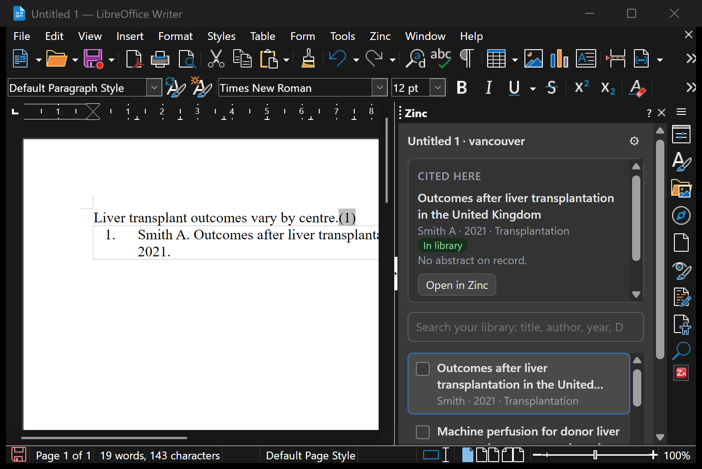

# The Zinc sidebar in LibreOffice Writer

Status: working on Windows (LibreOffice 26.8.3), 2026-11-19. Branch `claude/libreoffice-sidebar`.



_LibreOffice running on a hidden Windows desktop with the built `.oxt` installed. The page clicked a search result, which
inserted the citation; the Zinc menu's Insert Bibliography and Refresh did the rest. The cursor sits in the citation, so the
sidebar shows the cited item. Synthetic library._

## Goal

The same sidebar as in Word, docked inside Writer, with as little LibreOffice-only code as possible, and fast. Documents must
stay compatible with Zotero's LibreOffice plugin in both directions.

## What is shared and what is new

```
            word/sidebar bundle (main.ts UI, app.ts App, core/src/cite)      <- unchanged, one copy for Word and LibreOffice
                    |  host.call("doc.*" | "lib.*" | "style.*" ...) over window.chrome.webview
   Word:   PaneControl (WebView2, in Word's task pane) -> Bridge -> WordDoc (COM)        | Library / Styles / Settings (C#)
   Writer: ZincLibreOfficePane.exe (WebView2, child window of the sidebar panel)        | the SAME C# classes (ProjectReference)
                    |  doc.* only, JSON lines on stdin/stdout
           zinc.py + zinc_lo/ (Python UNO extension, in LibreOffice's process, main thread) -> LoDoc over UNO
```

- **Shared, unchanged:** the whole sidebar page and `App`. In Writer the page runs on the same WebView2 host
  (`createWebViewHost`) as in Word, so `host.ts` and `main.ts` did not change. One shared change in `app.ts`: a new document's
  preferences take `fieldType` from `host.info` ("ReferenceMark" in Writer, "Field" by default). Zotero checks that preference
  before it touches a document.
- **Shared C#:** `lib.*`, `style.*`, `locale.*`, `settings.*`, `zn.*` and `host.info` are answered by the Word add-in's own
  `Bridge`, `Library`, `Styles`, `Settings` and `ZnClient`. The pane references the add-in project; one `InternalsVisibleTo`
  line was added to `word/addin/Log.cs`. The pane also reads the same `settings.json` and finds the same library as Word.
- **New, LibreOffice-only:**
  - `libreoffice/extension/pythonpath/zinc_lo/lodoc.py`: the `doc.*` contract over UNO, the counterpart of `WordDoc.cs`.
  - `codes.py`: Zotero's storage format.
  - `pane.py`: the bridge to the pane process.
  - `zinc.py`: the sidebar panel factory and the menu commands.
  - `registry/*.xcu`: deck, panel, factory, protocol handler, menu and toolbar.
  - `libreoffice/pane/Program.cs` (about 350 lines): the WebView2 host window.

## Options weighed

### 1. Showing the page inside LibreOffice's sidebar

| Option | Verdict |
| --- | --- |
| Rebuild the UI from UNO/AWT controls | Rejected: a second UI to keep identical by hand, which is what the user does not want. |
| A separate browser window or floating tool window | Rejected: not docked. It would not follow the document window. |
| A web view inside the panel's native window | **Chosen.** |

LibreOffice has no embeddable browser of its own, so the web view comes from the platform. The panel creates a
`systemchildwindow` through the toolkit. Unlike ordinary VCL windows, this is a real native window, and
`XSystemDependentWindowPeer.getWindowHandle` returns its handle.

- **Windows (built and verified).** The handle is an HWND. A helper process, `ZincLibreOfficePane.exe` (.NET Framework 4.8,
  like the Word add-in), creates its window as a child of that HWND (`CreateParams.Parent`, `WS_CHILD`). The WebView2 sits
  inside it. Windows allows a child window to belong to another process. The pane follows the panel's size with a 150 ms
  check of the parent's client area. It takes the parent's DPI mode. It recreates its window if LibreOffice destroys the
  panel, while keeping the WebView2 browser process alive. The pane never blocks its UI thread on LibreOffice: it hands
  each `doc.*` request over and posts the answer when it arrives. While its window is LibreOffice's child, the two UI threads
  share input, so blocking would risk a deadlock.
- **macOS (not built).** The handle is an `NSView`. Cocoa cannot embed a view from another process, so the web view must
  live in LibreOffice's process. The plan: create a `WKWebView` from the extension's Python through the Objective-C runtime
  (`ctypes` and `objc_msgSend`; PyObjC is not bundled), add it as a subview, and pass messages through a
  `WKScriptMessageHandler`. `host.ts` would then need a small `webkit.messageHandlers` variant of `createWebViewHost`.
- **Linux (not built).** On X11 the handle is an X window id. A helper with WebKitGTK can embed itself with XEmbed
  (`GtkPlug`) or reparent its X window. Wayland has no embedding across processes: there, only an in-process WebKitGTK
  through `gi` could work, and only with LibreOffice's gtk3 interface plugin.

### 2. Where `doc.*` runs

In LibreOffice's own process, as a Python UNO extension (LibreOffice bundles Python 3.13). Requests run on the main thread,
posted in order through `com.sun.star.awt.AsyncCallback`. The alternative was the pane talking UNO to LibreOffice over a
socket. That turns every UNO call into an inter-process round trip, which was measured about 10× slower (see Speed). Java
or C++ extensions would be as fast as Python in-process, but need a JDK or the SDK to build. Python ships with LibreOffice.

Reads are batched the way the Word work showed matters:
- One pass collects every Zotero reference mark and section.
- It sorts them with `XTextRangeCompare`, keeping notes interleaved at their anchors like Zotero's `compareTo`.
- It measures only the text *between* neighbouring fields, giving character positions that the `App`'s merge test (`start <= last.end`) relies on.
- The last scan is kept, so the `doc.setMany` after a `doc.fields` finds each field by name instead of rescanning.

### 3. How `lib.*` reaches the library

| Option | Verdict |
| --- | --- |
| The Word add-in's C# `Library` (read-only SQLite) in the pane | **Chosen on Windows**: no new code, same library resolution and settings as Word, works without the Zinc app running. |
| Python `sqlite3` inside LibreOffice | The portable route for macOS and Linux (no C# there). LibreOffice's bundled Python has SQLite 3.54 **with FTS5** (checked on the Windows build), which the search needs. That would be a port of `Library.cs`/`Styles.cs`, about 300 lines. |
| The Zinc app's local API | Needs Zinc running. Fine as an extra (the sidebar already asks it for `zn.*`), not as the only route. |

### 4. Storage format

This is Zotero's, read from `zotero-libreoffice-integration` (`ReferenceMark.java`, `Document.java`), so a document moves
between Zotero and Zinc in either direction:
- **Citation:** a reference mark named `ZOTERO_ITEM CSL_CITATION {json} RND` followed by 10 letters or digits.
- **Bibliography:** a text section named `ZOTERO_BIBL {json} CSL_BIBLIOGRAPHY RND…`, with paragraph style "Bibliography 1".
- **Document preferences:** user-defined properties `ZOTERO_PREF_1…n`, in 255-character chunks, with `fieldType` "ReferenceMark".

The sidebar keeps speaking Word's code form (`ADDIN ZOTERO_ITEM …`); `codes.py` converts.

## Writer behaviours the code works around (all checked against 26.8.3)

- **A reference mark cannot be renamed.** A new code means a new mark over the same text.
- **`dispose()` on a reference mark deletes its text, and replacing all of a mark's text removes the mark.**
  To remove a mark *and keep its text and formatting* (unlink, code-only rewrite), the code uses `.uno:DeleteFields`
  (`TypeName=SetRef`, `NamePrefix=<the mark's full name>`). This command exists since LibreOffice 7.6, hence that minimum
  version in `description.xml`.
- **Writer grows a reference mark over text inserted at its end.** A citation inserted right after another one would land
  inside it. When something is written at a mark's end, `_insert_runs` puts that mark back over its own text. After an insert
  at the cursor, `.uno:ResetAttributes` moves what the user types next out of the field, which is Zotero's `getOutOfField`.
- **Paragraph breaks read back as CR LF but count as one cursor step.** Positions count cursor steps, and field text is
  reported with a single CR, as from Word.
- **Track Changes:** rewriting existing fields switches `RecordChanges` off for that call only, as the Word add-in does. New
  and deleted citations stay tracked. Tested: a refresh with tracking on leaves no tracked change.

## Speed (40-citation document)

| | In-process (as installed) | Remote UNO (test harness) |
| --- | --- | --- |
| `doc.fields` (read every citation) | 16.5–16.8 ms | 199–209 ms |
| `doc.cursor` (cursor read on selection change) | 0.24–0.27 ms | — |
| read + rewrite all 40 citations (one `doc.setMany`) | 80–116 ms | — |
| a refresh's `doc.*` calls | `fields, state, begin, setMany, setPrefs, end` — never one per citation | |

Opening the deck cold (first WebView2 profile) took about 3.3 s until the page had loaded. This was measured on the hidden
desktop. Reopening it reuses the pane's running browser process; that case was not timed.

## Tests

| Test | What it covers | How to run |
| --- | --- | --- |
| `libreoffice/test/test_codes.py` | the storage format | `python -m unittest discover -s libreoffice/test -p "test_*.py"` |
| `word/sidebar/test/app.test.ts` (new case) | `fieldType` from `host.info` | `bun test` in `word/sidebar` |
| `word/sidebar/test/libreoffice-e2e.test.ts` | 9 cases with the real `App` against a private headless LibreOffice: insert, bibliography, Zotero names and prefs, save/reopen ODT, style change with formatting, Track Changes, footnotes there and back, merge/split, a Zotero-written document, unlink, speed | `ZN_LO_E2E=1 ZN_LO_PROGRAM=<LibreOffice>/program bun test test/libreoffice-e2e.test.ts` |
| `word/sidebar/test/libreoffice-pane.test.ts` | the real page in the pane (off-screen window): search through the C# library code, a click inserts a citation, Insert bibliography, Refresh | same variables, after `pwsh libreoffice/build.ps1` |
| `word/sidebar/test/libreoffice-extension.test.ts` | `unopkg add` of the `.oxt` into a temp profile; components load; deck, panel, menu and commands are registered | same |
| `libreoffice/test/gui-check.ps1` | a windowed LibreOffice on a **hidden Windows desktop** (never shown): the deck opens, the pane docks into the panel window, a click in the page cites, the menu inserts the bibliography and refreshes, the cursor shows "Cited here"; saves the picture above | `pwsh libreoffice/test/gui-check.ps1 -Program <LibreOffice>\program -Out <dir>` |

## Not done or not verified

- **macOS and Linux:** designed (above), not built. `description.xml` limits the extension to `windows_x86_64` for now.
- **Real mouse and keyboard in the docked pane:** focus moving into and out of the page, Tab order, IME input, and drag
  between monitors with different scaling were not tried. Testing stayed off the visible screen, and the hidden desktop has
  no real input.
- **Zotero's "Bookmark" field type** (`ZOTERO_BREF_…` plus document properties) is neither read nor written. Word's add-in
  does not do bookmarks either.
- Citations in headers, footers and text frames sort after everything else, as in Zotero. `doc.locate` positions do not
  cross tables.
- The Word add-in's citation hover popup and agent (MCP) server are not ported.
- Opening a Zotero-made document from *Zotero itself* was not tried (Zotero is not installed here). Compatibility rests on
  matching the plugin's source and on a test that refreshes a document written in its exact format.
- DOCX saved from Writer: whether LibreOffice exports these reference marks as Word `ADDIN` fields was not checked.
- No installer or signing. The `.oxt` is installed with Tools > Extensions or `unopkg add`.
- The pane writes its log to the Word add-in's cache folder (`%LOCALAPPDATA%\ZoteroNextWord\addin.log`, lines starting
  "libreoffice pane:"). The extension writes to `%LOCALAPPDATA%\ZincLibreOffice\extension.log`.
