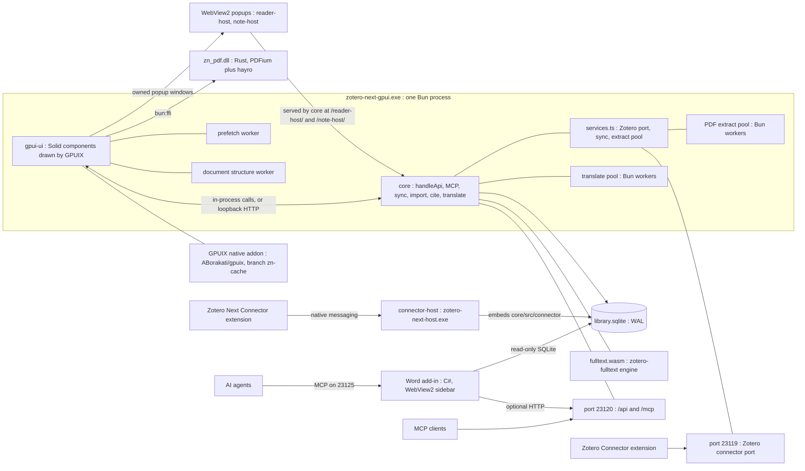

# Architecture

Zotero Next is a Windows desktop reference manager that reads and writes a Zotero-format library kept in one SQLite file. The user interface, the core service that owns the database, and most background work run inside a single Bun process. A few things live outside that process: the Word add-in, the browser-connector host, and the WebView2 pages used for web content.

This page is the map. Details are in [Building](building.md), [Testing](testing.md), [Database](database.md), [HTTP API](http-api.md) and [Translators](translators.md).

## Overview

## Repository layout

| Path | What is in it |
| --- | --- |
| `gpui-ui/` | The app: `src/` (UI), `native/pdf/` (Rust PDF library), `scripts/` (build, package, release, screenshot and benchmark scripts), `installer/` (Inno Setup), `UPDATES.md` |
| `core/` | The core service: `src/` (database, migrations, HTTP API, MCP, sync, import and export, translators, citations), `schema.sql`, `scripts/`, `test/`, `vendor/` (git-ignored) |
| `word/` | `addin/` (C# COM add-in, .NET Framework 4.8), `sidebar/` (TypeScript sidebar and agent API), `harness/` (test harness), `build.ps1`, `install.ps1`, `uninstall.ps1` |
| `connector-host/` | Native-messaging host for the browser connector (`src/`, `test/`, `install.ps1`, `uninstall.ps1`) |
| `reader-host/` | Host page for Zotero's web reader, used by snapshot and EPUB tabs (`build.sh`, `src/`, `dist/`) |
| `note-host/` | Host page for Zotero's note editor (`build.sh`, `src/`, `dist/`) |
| `vendor/` | Upstream Zotero repositories cloned by the build scripts (document-worker, reader, note-editor). Git-ignored |
| `scripts/` | `build-docworker.sh` and `shims/` |
| `website/` | Project website sources (Astro): product pages and the docs |
| `docs/` | Documentation: `user-guide/`, `developer-guide/`, `screenshots/` |
| `data/` | A local library kept by a developer. Git-ignored; never commit or script against it |
| `.github/workflows/` | `ci.yml` and `fuzz-nightly.yml` |

The old Electrobun app (`app/`, `ui/`) is not part of this documentation.

## The app process

`gpui-ui/src/main.tsx` is the entry point. It renders a splash screen first, registers fonts, and only then imports the heavy modules (the app, the store, the core), so the window appears before the core has loaded.

The UI is TypeScript with Solid components. GPUIX (a Solid adapter for Zed's GPUI) draws it natively; there is no browser engine in the main window. Features plug into the shell through the registry in `gpui-ui/src/registry.ts` (item actions, app actions, overlays, sidebar sections, settings sections); see [Contributing](contributing.md).

### Core in the same process

`gpui-ui/src/core.ts` decides where the core runs:

| Setting | Behaviour |
| --- | --- |
| `ZN_DB=<library copy>` | The app starts the core itself on that database and starts an HTTP server on loopback. |
| `ZN_DB` plus `ZN_CORE_DIRECT=1` | No HTTP at all. `gpui-ui/src/api.ts` calls the core's `handleApi(Request, db)` directly. Nothing else (MCP, connector, a browser) can reach the core, and web tabs and the web note editor are off. |
| neither | An external core at `ZN_URL` (default `http://127.0.0.1:23160`). |
| packaged exe | Always runs the core in-process. The database comes from `core/src/library-location.ts` (see [Database](database.md)). |

The core writes to its database. An unpackaged run refuses the real library path unless `ZN_ALLOW_REAL_DB=1`; use a `VACUUM INTO` copy for development.

### Ports

| Port | Owner | Purpose |
| --- | --- | --- |
| 23120 | `core/src/server.ts` | The core HTTP API under `/api`, the MCP endpoint `/mcp`, and static mounts `/reader-host/` and `/note-host/`. Default for the packaged app; an unpackaged in-process run defaults to 23161 (`ZN_PORT` overrides). If the wanted port is taken, the core takes a free loopback port and leaves sync and port 23119 to the other instance. |
| 23119 | `core/src/zport/index.ts` | The Zotero-compatible "Zotero port" for the Zotero Connector extension and Better BibTeX endpoints. Started by `gpui-ui/src/services.ts`, only while Zotero itself is not holding the port, retried every 30 seconds. |
| 23125 | `word/addin/McpServer.cs` | The Word add-in's own MCP server (setting `mcpPort`, default 23125; `mcpEnabled`, default on). Separate from the core's `/mcp`. |

Details of the routes are in [HTTP API](http-api.md).

### Services

`gpui-ui/src/services.ts` runs in the packaged app (or with `ZN_SERVICES=1`): the Zotero port, two-way sync with the local Zotero library, the PDF text-extraction pool, the native folder dialog for Settings, and clean shutdown. `ZN_SYNC=0` and `ZN_ZPORT=0` turn two of them off.

### Worker threads

| Worker | Source | Notes |
| --- | --- | --- |
| Translate pool | `core/src/translate/pool.ts`, `worker.ts` | Runs Zotero translators. Up to 2 workers, one job at a time each, 60 s default timeout, replaced after a timeout or 50 jobs. See [Translators](translators.md). |
| PDF extract pool | `core/src/extract/pool.ts`, `pdf-worker.ts` | Runs Zotero's document-worker (pdf.js) for full-text extraction. Hard per-job timeout, workers recycled after 40 jobs. |
| Prefetch worker | `gpui-ui/src/prefetch.ts`, `prefetch-worker.ts` | Answers the first screen's GET requests from a read-only connection while the main thread creates the window. Needs `ZN_DB`; `ZN_PREFETCH=0` turns it off. |
| Document-structure worker | `gpui-ui/src/reader/structure/worker.ts`, `docworker-entry.ts` | Runs Zotero's document-worker for the reading view (citations, figures, layout). |

## PDF rendering: `gpui-ui/native/pdf`

A Rust cdylib (`zn_pdf`) that renders pages with PDFium (loaded at run time from `pdfium.dll`) and uses the pure-Rust `hayro` crate for the text layer, links and outline. `hayro` also renders when PDFium cannot be loaded (`ZN_PDF_BACKEND=hayro` forces it). The app loads `zn_pdf.dll` through `bun:ffi` in `gpui-ui/src/reader/pdf.ts`; rendering jobs run on Rust worker threads and are polled from JS so the UI thread is never blocked. See [Building](building.md) for how the DLL is built.

## WebView2 pages

GPUIX has no web-view element, so the few places that need web content use WebView2 through `webview-bun`. `gpui-ui/src/webview/host.ts` creates each WebView2 in a frameless popup window owned by the main window and keeps it positioned over a placeholder element. Nothing is created until first use and it is destroyed on release, because the WebView2 processes cost roughly 100 to 200 MB.

| Page | Directory | Served at | Used for |
| --- | --- | --- | --- |
| Reader host | `reader-host/` | `/reader-host/` | Web tabs: HTML snapshots and EPUBs, in Zotero's web reader (`WebTabView.tsx`) |
| Note host | `note-host/` | `/note-host/` | Zotero's note editor in the item pane (`gpui-ui/src/webview/notes.ts`) |

`gpui-ui/src/webview/mounts.ts` registers the two static mounts on the core server. If a `dist/` folder is missing, that mount is left out and the feature falls back (web tabs open in the default app; notes use the built-in Markdown editor). Both builds need the upstream clones under `vendor/`, built by `reader-host/build.sh` and `note-host/build.sh`.

## The core: `core/`

`core/src/api.ts` is the request router; `core/src/server.ts` wraps it in `Bun.serve`. Feature areas have their own folders and route modules: `additems/`, `bbt/` (Better BibTeX), `cite/` (citation styles and formatting), `duplicates/`, `files/`, `fulltext/` (Find Full Text), `import/` and `io/`, `integrations/`, `maintenance/`, `references/`, `searches/`, `sync/` (local Zotero), `websync/` (zotero.org), `translate/`, `update/` (auto-update logic), `mcp/`, `connector/` and `zport/`.

### Full-text engine

Find Full Text runs the zotero-fulltext engine as a WebAssembly module (`core/src/fulltext/wasm.ts` loads `core/vendor/fulltext-wasm/fulltext.wasm`; `host.ts` is the Bun host that performs the engine's effects). The engine is built in a separate private repository (`ABorakati/zotero-fulltext`) and is not in this repo. A fresh checkout needs at least an empty placeholder file at that path; see [Building](building.md) and [Testing](testing.md).

### SQLite library

One SQLite file in WAL mode holds items (as Zotero Web API JSON plus query columns), collections, tags, annotations, the sync outbox and settings state. See [Database](database.md).

## The GPUIX fork

The app runs a locally built `@gpuix/native` addon instead of the npm 0.11.0 binary. It adds a `cacheRegion` style key so that unchanged regions (sidebar, toolbar, item pane) are replayed instead of rebuilt when only the list scrolls. The source is the private repository `ABorakati/gpuix`, branch `zn-cache`. The addon is copied over the npm binary by hand after every `bun install`; without it the app still works with whole-window redraws. Instructions are in `gpui-ui/scripts/README.md` ("Custom GPUIX native addon") and summarised in [Building](building.md).

## Word add-in: `word/`

| Part | Technology | Role |
| --- | --- | --- |
| `word/addin/` | C#, .NET Framework 4.8, COM add-in (no VSTO runtime, no admin rights) | Registers with Word per user, hosts the sidebar in a Custom Task Pane, reads the library read-only through `winsqlite3.dll` (`Sqlite.cs`, `Library.cs`), and runs the MCP server (`McpServer.cs`) |
| `word/sidebar/` | TypeScript, bundled by `build.ts` | The sidebar UI (`main.ts`), the popup, and the agent API (`agent-main.ts`) that executes MCP tools in a hidden WebView2 (`AgentHost.cs`) |
| `word/harness/` | C# | Test harness used by the end-to-end tests |

The add-in finds the library with the same rule as `core/src/library-location.ts` (`word/addin/Settings.cs` mirrors it). The link to a running app is optional (`ZnClient.cs`, default `http://127.0.0.1:23120`). The MCP server requires a bearer token stored per user and refuses requests that carry an `Origin` header.

## Browser connector host: `connector-host/`

`zotero-next-host.exe` is a Bun-compiled native-messaging host started by Chrome or Edge for the Zotero Next Connector extension (a fork kept in a separate repository). It embeds `core/src/connector` and runs the same connector handlers as port 23119 directly against the library database, so saving works with the app closed. It is registered per user in HKCU by `connector-host/install.ps1`. Protocol framing is in `connector-host/src/frames.ts`.
