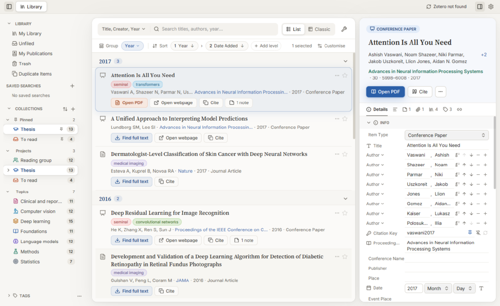
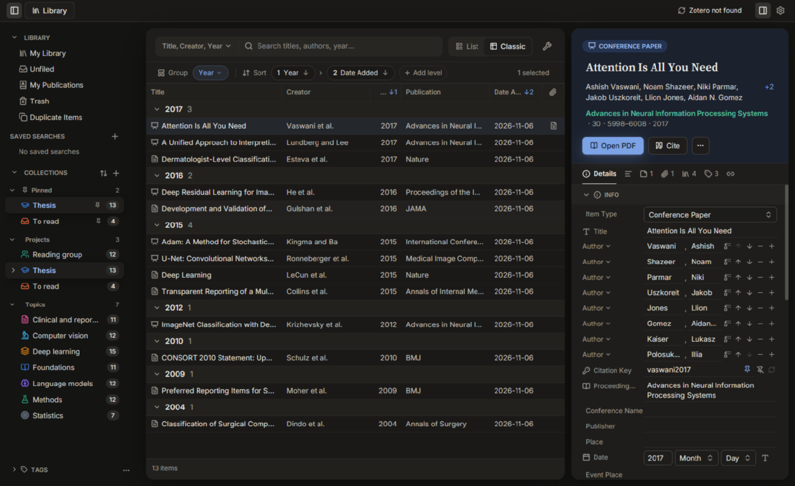

# Library basics

The main window has three panes: the sidebar on the left (library views, saved searches, collections and tags), the item list in the middle, and the item pane on the right. The two side panes can be hidden from the top bar or from **Settings > General** ("Show the sidebar", "Show the item pane").

## The item list

The toolbar above the list has a search box, a view switch (**List** and **Classic**), a tools menu (the wrench icon) and the **Add** button.

### List and Classic views

| View | What it shows |
|---|---|
| **List** | One card per item: title, coloured tag badges, creators, publication, year and item type, and a row of buttons (for example **Open PDF**, **Open webpage**, **Cite**, **Find full text**, and a note count). |
| **Classic** | A table, one row per item, with sortable columns. |

Choose the view the library opens in under **Settings > General > Default view** (the setting calls the two views "Cards" and "Table").

**Customising cards.** In the List view, click **Customise** at the right of the sort bar. The dialog lets you choose:

- the title line: a star toggle, coloured tag badges, and optionally uncoloured tags too;
- the authors line: full list, "3 + et al.", summary, or hidden;
- the details line: which fields appear, in what order (use **Add field…**, the arrows and the remove button);
- the icons line: notes, PDF and attachments;
- density: **Comfortable** or **Compact**.

**Reset** restores the defaults.

**Customising columns.** In the Classic view the column picker follows Zotero's list: Title, Creator, Item Type, Date, Year, Publisher, Publication, Journal Abbr, Language, Accessed, Library Catalog, Call Number, Rights, Date Added, Date Modified, Archive, Loc. in Archive, Place, Volume, Edition, Number, Pages, Issue, Series, Section, Short Title, Extra, Citation Key, Attachments, Notes and DOI, plus any other field the item schema defines. The default columns are Title, Creator, Year, Publication, Date Added and Attachments.

### Grouping and sorting

The bar under the toolbar controls both:

- **Group**: None, Year, Item type or Publication. The default is Year. Each group gets a collapsible header with a count.
- **Sort**: up to four levels. Click a level chip to pick its field, click the arrow or "A-Z" part to reverse it, and use **Add level** for a tie-breaker. When the list is grouped, the first level is the grouping field and cannot be removed.

The right-hand end of the bar shows the item count, or "N selected" while items are selected.

### Searching

The search box filters the current view. The box on its left sets what it searches (also under **Settings > General > Quick search mode**):

| Mode | Matches |
|---|---|
| Title, Creator, Year | Words in the title, creators or year |
| All Fields & Tags | Any field, creator or tag |
| Everything | Also notes and attachment full text |

Press `Ctrl+F` to search the library. For multi-condition searches use [Advanced Search](#saved-searches).

### Unread dots

A small accent dot marks items you have not opened. Turn it off with **Settings > General > Show unread dots**. Use **Mark as Read** or **Mark as Unread** in the item menu. This state is stored only on this computer (in `%APPDATA%\zotero-next-gpui\read-state.json`) and is not synced.

### The item menu

Right-click an item (or a selection) for the menu:

- **Open**, and **Locate** (see [Locate engines](locate-engines.md));
- **Find Full Text** and **Find Full Text (open access only)** (see [Find Full Text](find-full-text.md));
- **Mark as Read** and **Mark as Unread**;
- **Show in collection…**, **Add to collection**, **Copy DOI**;
- **Show in My Publications** or **Remove from My Publications**;
- entries for adding notes and attachments, **Duplicate Item**, **Merge Items…** (with two or more items selected), **Copy Bibliography**, **Copy Citation**, **Retrieve Metadata for PDF**, **Create Parent Item…** and **Rename File from Parent Metadata** where they apply;
- **Move to Trash**.

### Keyboard shortcuts

Press `Ctrl+/` (or choose **Tools > Keyboard Shortcuts**) to see the list in the app. The library shortcuts are:

| Keys | Action |
|---|---|
| `Ctrl+Shift+N` | New item |
| `Ctrl+Shift+I` | Add item by identifier |
| `Ctrl+Shift+C` | Copy bibliography of the selected items |
| `Ctrl+Shift+A` | Copy citation of the selected items |
| `Delete` | Move selected items to the Trash (permanently delete when in the Trash) |
| `Shift+Delete` | Delete selected items permanently |
| `Ctrl+A` | Select all items |
| `Ctrl+F` | Search the library |
| `Ctrl+Shift+F` | Advanced Search |
| `Ctrl+Shift+L` | Focus the collections pane |
| `+` and `-` | Expand and collapse all collections |
| `Ctrl+W` | Close the current tab |
| `Ctrl+,` | Settings |

## Library views

The top group of the sidebar, **Library**, holds fixed views:

| View | Contents |
|---|---|
| **My Library** | Every item that is not in the Trash. |
| **Unfiled** | Items that are in no collection. |
| **My Publications** | Items you have marked as your own work. |
| **Trash** | Deleted items. |
| **Duplicate Items** | Opens the duplicate merge dialog. |

### My Publications

Right-click an item and choose **Show in My Publications** to add it, or **Remove from My Publications** to take it out. Only regular top-level items can be added (not attachments, notes or annotations). The view is a filter over your library, so removing an item from it does not delete the item.

### Trash

**Move to Trash** (or `Delete`) is reversible. In the Trash view the item menu offers **Restore** and **Delete Permanently…**. Right-click the **Trash** row, or use **Tools > Empty Trash…**, to delete everything in it. Emptying the Trash is permanent and is pushed to your Zotero library at the next [sync](sync.md).

### Duplicates

The **Duplicate Items** row shows a count of duplicate sets. Selecting it (or **Tools > Duplicate Items…**) opens a dialog with the sets on the left. Sets are found by matching DOI, ISBN or title, and you can filter the list by those reasons.

For the chosen set you pick the master item (the oldest by default) and, for each field that differs, which version's value to keep. **Merge N items** keeps the master, moves the others to the Trash, and combines their tags, collections, child items and relations. **Not Duplicates** marks the set so it is not offered again. You can also select two or more items and choose **Merge Items…** from the item menu to merge a set of your own choosing.

## Collections

Collections are the folders of the sidebar. Click the **+** at the right of the **Collections** header (or right-click the header and choose **New collection**) to create one, and type a name. Drag items onto a collection to add them; an item can be in many collections. Collections can contain subcollections.

Right-click a collection for its menu:

| Entry | Effect |
|---|---|
| **New subcollection** | Creates a child collection. |
| **Rename** | Renames in place. |
| **Pin to top** / **Unpin** | Shows or removes a copy in the **Pinned** group at the top. |
| **Colour** | Tints the folder: Blue, Sky, Green, Amber, Rust, Rose, Violet or Slate, or **None**. |
| **Icon** | Replaces the folder with one of a set of icons (book, star, flask, microscope and so on), or **Folder (default)**. |
| **Move to section** | Puts a top-level collection in a named section (see below). |
| **Move to top level** | Appears on subcollections. |
| **Delete…** | Deletes the collection only; the items inside stay in your library. |

### Sections, sorting and grouping

The **⋯** menu of the Collections header sets how the list is arranged:

- **Sort by**: Name A-Z, Name Z-A, Date created, Date modified, Number of items.
- **Group by**: None, By colour, or By section.

A section is a heading you make yourself. Use **Move to section > New section…** on a collection, then group the list **By section** to see them. Right-click a section header to **Rename section** or **Delete section**.

**Local only.** Colours, icons, sections and pins are presentation settings stored on this computer (in `%APPDATA%\zotero-next-gpui\collection-style.json`). They are not part of your Zotero library and are not synced.

## Tags

The **Tags** pane at the bottom of the sidebar lists the tags in the library as pills, with a **Filter tags** box. Click a tag to filter the item list by it; click several and they combine (an item must have all of them). The **⋯** menu offers **Show Automatic** (tags added by importers and translators are hidden by default), **Deselect All**, and **Delete Automatic Tags in This Library…**.

Right-click a tag for:

- **Assign Colour…**: Red, Orange, Gray, Green, Teal, Blue, Navy, Purple or Plum. Coloured tags appear first in the pane, show a dot, and appear as badges on cards. **Remove colour** undoes it.
- **Rename Tag…**: if the new name already exists the two tags are merged.
- **Delete Tag…**: removes the tag from every item.

The palette is Zotero's tag palette. Colours are stored in the library database.

## Saved searches

**Tools > Advanced Search…** (`Ctrl+Shift+F`) opens a condition editor. Each condition is a field, an operator and a value. Fields include Title, Creator, Year, Date, Date Added, Date Modified, Publication, Item Type, Tag, Collection, Note, Attachment File Type, Attachment Content, All Fields & Tags, and any other item field under **More fields**. Operators depend on the field: is, is not, contains, does not contain, begins with, is before, is after, is in the last. The **Match** control sets whether all or any conditions must hold. Options let you search subcollections, include items in the Trash, include parent and child items of matches, and show only top-level items.

Give the search a name and click **Save** to keep it. Saved searches appear under **Saved Searches** in the sidebar (the **+** there opens a new search). Right-click one for **Edit Search…**, **Rename** or **Delete…**. Deleting a saved search never deletes items.

## The item pane

Selecting an item shows its details on the right. At the top is the header with the item type, title, creators, publication and date, and the buttons **Open PDF** (or **Open EPUB** or **Open snapshot**), **Cite** (copies a citation), **Find full text** (when there is no PDF yet) and a **⋯** menu with **Locate**, **Copy bibliography**, **Copy DOI** and **Find full text again**.

Below the header a tab row jumps between sections of one scrolling pane:

| Tab | Section |
|---|---|
| **Details** | Editable fields of the item (click a field to edit it). Changing the item type changes the available fields. |
| **Abstract** | The abstract. |
| **Notes** | Child notes of the item; see [Notes and web tabs](notes-and-web-tabs.md). |
| **Files** | Attachments (PDFs, snapshots, links). |
| **Collections** | The collections the item belongs to. |
| **Tags** | The item's tags. |
| **Related** | Items related to this one. |

Selecting several items shows a summary instead. Edits are saved as you make them and picked up by the next [sync](sync.md).

Next: [Adding items](adding-items.md), [The reader](reader.md).
