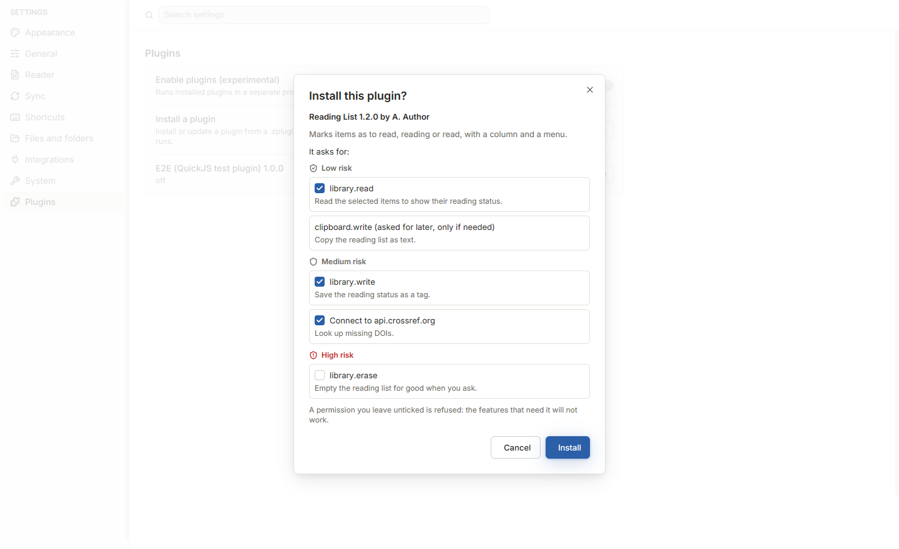
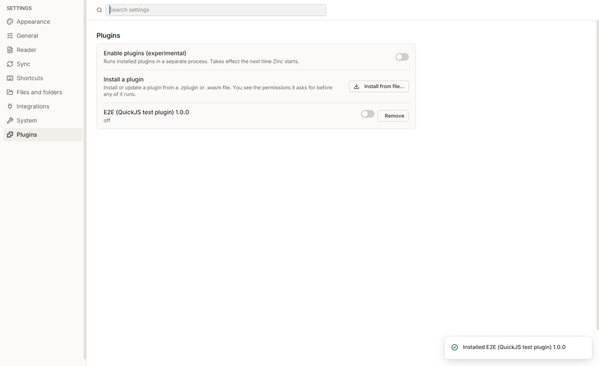

# Plugins

Plugins add features to Zinc: menu commands, item list columns, item pane sections, settings panes, reader buttons, and tools for AI agents. Zinc plugins are not Zotero plugins. They are WebAssembly programs written for Zinc, and each one runs in a separate process with only the permissions you give it. A Zotero plugin has to be ported first (see [Writing a Zinc plugin](../developer-guide/wasm-plugins/writing-a-plugin.md) and the [agent skills for plugin authors](../developer-guide/wasm-plugins/agent-skills.md)).

Plugins are **experimental** in 0.2 and **off by default**. While they are off, Zinc starts no plugin process and behaves exactly as without them.

## Turn plugins on

1. Open Settings (**Ctrl+,**) and go to **Plugins**.
2. Turn on **Enable plugins (experimental)**.
3. Quit Zinc and start it again. The switch takes effect at the next start, in both directions.

When plugins are on, Zinc starts the plugin host at startup and then every installed, enabled plugin. Each plugin registers its menus, columns, sections and panes as it starts. When a plugin stops, is disabled or fails, everything it added disappears from the window.

The switch is stored as `shell.wasmPlugins` in `ui-state.json` (see [Settings reference](settings.md)). Starting Zinc with the environment variable `ZN_WASM_PLUGINS=1` turns plugins on for that run, whatever the switch says.

## Install a plugin

A plugin comes as one file, in either of two forms. Zinc installs both the same way:

- **`.zplugin`**: a zip that holds `manifest.json` (the plugin's name, version and the permissions it asks for), `plugin.wasm` (its code) and its strings and icons.
- **`.wasm`**: the plugin's code with the same manifest, strings and icons stored inside it, in a data block that carries no code (a custom section named `zinc:package`). It is larger than the `.zplugin`, because nothing in it is compressed. A plain `.wasm` without that block is refused: nothing would say what the plugin is or what it may do.

Install it from Settings (Zinc 0.2.3 or later):

1. Turn plugins on and restart Zinc (above). The install button stays greyed out until plugins are running.
2. Settings > Plugins > **Install a plugin** > **Install from file...**, and pick the `.zplugin` or `.wasm` file.
3. Zinc checks the package before anything of it runs: its files, its manifest, that it fits this version of Zinc, and that `plugin.wasm` matches its recorded hash. A package that fails a check is refused, with the reason, and nothing is installed.
4. **Install this plugin?** shows the plugin's name, version, author and description, and the permissions it asks for, grouped by risk, each with the plugin's reason. Low- and medium-risk permissions start ticked; high-risk ones start unticked, so you must tick them yourself. Optional permissions are listed but not granted now (see below). Untick anything you do not want to allow: the plugin still installs, and the features that need that permission do not work.
5. Choose **Install**. The plugin starts at once and a message confirms it. **Cancel** installs nothing.



Installing another version of a plugin you already have updates it in place: it keeps its settings and data. If the new version asks for permissions you have not seen, the prompt (**Update this plugin?**) lists only those; otherwise it installs without asking. An update that reached Zinc without the prompt and asks for new permissions stays off until you approve them: its row in Settings > Plugins then has a **Review permissions...** button.

## Settings > Plugins



The section lists every installed plugin with its name, version and status. Each row has:

- a switch to turn the plugin **on or off**. A plugin you turn off is stopped and unloaded (it uses no memory) and stays off after a restart; turning it on starts it again.
- **Remove**, which asks first and then stops the plugin and deletes it with its settings, saved data and secrets. Your library is not touched.
- **Review permissions...**, only when an update is waiting for your approval.

| Status | Meaning |
| --- | --- |
| running | Started and working. |
| loading, loaded, starting | On its way up. |
| stopping, stopped | Shut down; it offers nothing. |
| off | You turned it off. |
| disabled | Waiting for you to approve new permissions, or turned off by Zinc, with the reason. |
| failed | It crashed or kept timing out. Zinc stops a plugin that does not answer in time, without affecting the rest of the app. The row shows the reason; [Logs and Report a problem](logs-and-reports.md) has more. |
| incompatible, blocked | It does not fit this version of Zinc, or this version of it is blocked. It is not started. |

A plugin that has a settings pane of its own gets its own section in Settings, after Plugins, with its icon and name.

## Try a plugin without installing it

For plugin authors and testing: Zinc can load built plugin folders straight away, without installing them.

1. Unzip a `.zplugin` file (or use the build output) in a folder of its own. A single-file `.wasm` cannot be loaded this way: install it.
2. Quit Zinc, then start it with `ZN_WASM_PLUGIN_DIRS` set to that folder. Separate several folders with `;` on Windows and `:` on Linux and macOS.

```powershell
$env:ZN_WASM_PLUGINS = "1"; $env:ZN_WASM_PLUGIN_DIRS = "C:\plugins\word-count"; & "$env:LOCALAPPDATA\Programs\Zinc\zotero-next-gpui.exe"
```

A plugin loaded this way gets every permission its manifest declares, without asking. It shows in Settings > Plugins with "loaded from a folder" and has no switch or Remove button; it is gone at the next start without the variable. Load only plugins you trust.

## Permissions

A plugin can do only what its permissions allow. Showing menus, columns, sections, settings panes, dialogs and notifications needs no permission. Everything that reads or changes your data does, for example:

| Permission | Risk | Lets the plugin |
| --- | --- | --- |
| `library.read` | Low | Read items, collections and tags, and see which items are selected. |
| `library.write` | Medium | Change items, add tags and notes. |
| `library.trash`, `library.erase` | Medium, High | Move items to the trash; delete them for good. |
| `library.files.read` | Medium | Read attachment files. |
| `reader.ui` | Low | Add buttons and menu entries to the reader. |
| `mcp.expose` | Medium | Offer tools to AI agents (see below). |
| web addresses | Shown by name | Connect to the listed websites, and only those. |

Each permission comes with the plugin's own sentence saying why it needs it. You decide on each one in the install prompt.

Some permissions are optional: the plugin asks for them only when you use the feature that needs them. Zinc then shows **Allow this plugin to do more?** with the plugin's name, the permission, its risk level and the plugin's reason. Choose **Allow** or **Don't allow**. Escape or closing the dialog counts as Don't allow, and the plugin carries on without that feature.

## Tools for AI agents

A plugin can offer tools to AI agents through Zinc's [MCP server](mcp.md#tools-from-plugins), for example a tool that counts the items with a tag. Two things must both hold before an agent sees them:

- The plugin has the `mcp.expose` permission.
- You turned on its switch. Settings > Plugins shows a row **Offer <plugin>'s tools to AI agents** under each plugin that asks for `mcp.expose`, with the number of tools it declares. The switch is **off** by default.

With the switch on, an agent connected to Zinc's HTTP MCP endpoint can do whatever the plugin is allowed to do: a plugin with `library.write` can change your library through its tools. Turn it on only for plugins you trust. Turning it off removes the tools at the agent's next request. A plugin that is not running offers nothing. The switches are stored as `shell.wasmPluginMcp` in `ui-state.json`.

## Where plugins live

| System | Folder |
| --- | --- |
| Windows | `%APPDATA%\zotero-next-gpui\plugins` |
| macOS | `~/Library/Application Support/zotero-next-gpui/plugins` |
| Linux | `$XDG_DATA_HOME/zotero-next-gpui/plugins`, else `~/.local/share/zotero-next-gpui/plugins` |

The environment variable `ZN_PLUGINS_DIR` points Zinc at another folder. Inside it:

| Path | Holds |
| --- | --- |
| `installed/<id>/` | Each installed plugin's files |
| `data/<id>/` | The plugin's own files |
| `prefs/<id>.json` | The plugin's settings |
| `secrets/` | API keys and tokens the plugin saved, encrypted (on Windows the key is protected by your Windows account) |
| `cache/` | Compiled copies of the plugins for this computer; safe to delete, rebuilt when needed |
| `state.json`, `grants.json` | Which plugins are installed and enabled, and the permissions you granted |

Removing a plugin (Settings > Plugins > **Remove**) deletes its folder, data, settings and secrets. Plugins never see these folders directly: a plugin reads and writes only its own `data` folder, its temporary folder, and files you pick or drop on it.

## Writing plugins

See [WASM plugins for Zinc](../developer-guide/wasm-plugins/README.md) in the developer guide, and [Writing a Zinc plugin](../developer-guide/wasm-plugins/writing-a-plugin.md) to start.
