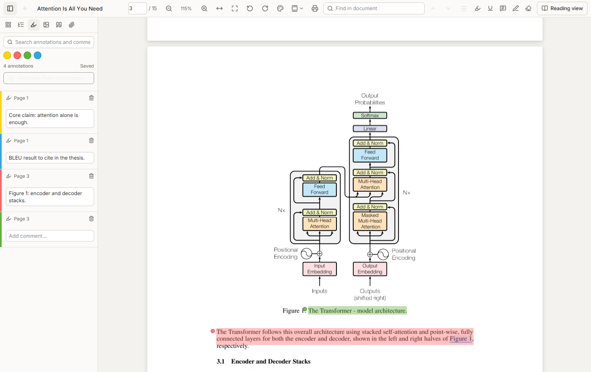
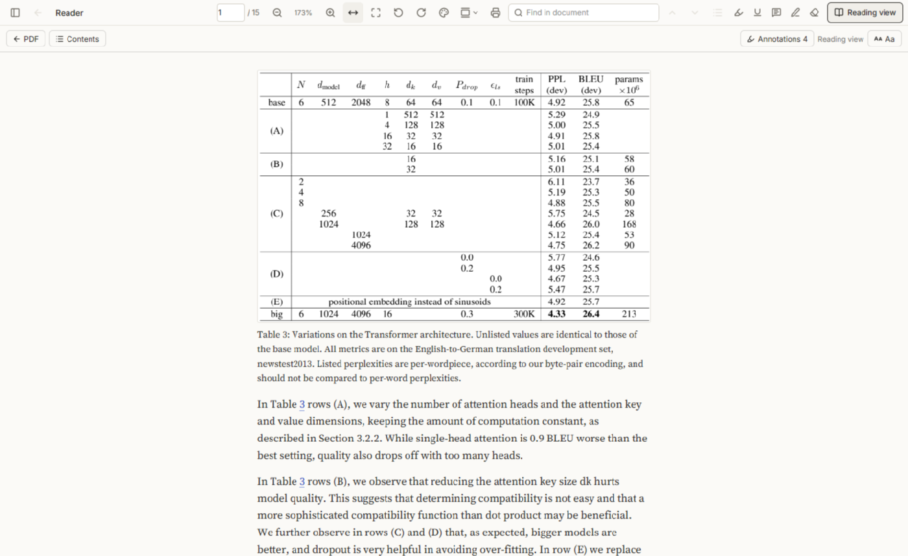
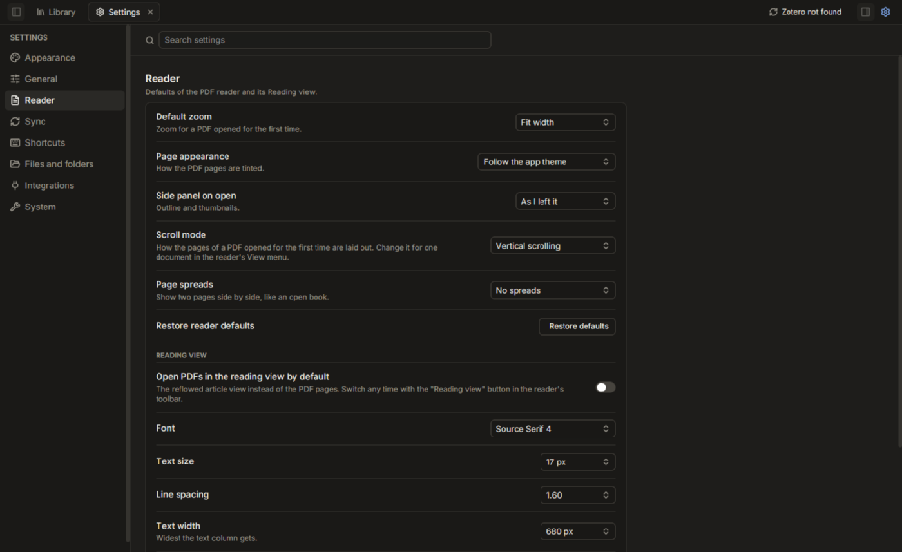

# The PDF reader

Click **Open PDF** on an item, or choose **Open** from its menu, to open the PDF in a tab of the main window. The reader draws the pages natively, remembers the page, zoom and rotation of each document, and stores annotations in the library so they are shared with Zotero on [sync](sync.md).

## The toolbar

| Control | Action |
|---|---|
| Sidebar button | Show or hide the side panel (see below). |
| Back (`Alt+Left`) | Return to where you were before following a link. |
| Page box | Type a page number to jump to it. |
| Zoom out (`Ctrl+-`), Zoom in (`Ctrl+=`) | Change the zoom. `Ctrl` plus the mouse wheel also zooms. |
| Fit width (`Ctrl+0`), Fit page | Set the zoom to fit the window. |
| Rotate left (`Ctrl+[`), Rotate right (`Ctrl+]`) | Rotate the view. |
| Page appearance | Tint the pages (see [Page appearance](#page-appearance)). |
| View menu | Page layout, page commands and Print (see below). |
| Print (`Ctrl+P`) | Print the document. |
| **Find in document** | Search the text; use the arrows or `F3` and `Shift+F3` to step through matches, and the match list button to see them all. |
| Annotation tools | Highlight, underline, note, ink and eraser (see below). |
| **Reading view** | Switch to the reflowed view (see below). |

### Navigation and keyboard shortcuts

| Keys | Action |
|---|---|
| `Page Down`, `Page Up`, `Space`, `Shift+Space` | Scroll by most of a screen. |
| `Home`, `End` | First and last page. |
| `Up`, `Down` | Scroll a little. With horizontal scrolling, move to the next or previous page. |
| `Left`, `Right` | Previous and next page (or pan sideways when the page is wider than the window). |
| `Ctrl+F` | Focus the find box. |
| `Ctrl+G`, `Ctrl+Shift+G` | Next and previous match. |
| `F3`, `Shift+F3` | Next and previous match. |
| `Ctrl+=`, `Ctrl+-`, `Ctrl+0` | Zoom in, zoom out, fit width. |
| `Ctrl+]`, `Ctrl+[` | Rotate right and left. Add `Shift` to rotate only the current page. |
| `Ctrl+C` | Copy the selected text. |
| `Ctrl+P` | Print. |
| `Alt+Left` | Go back after following an internal link. |
| `Esc` | Clear the selection, or close an open card or menu. |

Internal links in the PDF (contents, citations, cross-references) jump within the document, and web links open in your browser.

## The side panel

The tabs of the side panel are icons; hover one for its name. The reader has:

- **Pages**: thumbnails. Click to jump. Select pages and right-click for page commands.
- **Outline**: the PDF's table of contents, when it has one.
- The match list button next to the find box shows the matches in the panel.
- **Annotations**: every annotation in document order (see below).
- **Figures & Tables**, **References** and **Supplementary** (see [Cards for figures, references and citations](#cards-for-figures-references-and-citations)).

Whether the panel is open when a PDF opens is set in **Settings > Reader > Side panel on open** (As I left it, Always open, Always closed).

## Page layouts

The **View** menu sets the layout for the current document:

| Group | Choices |
|---|---|
| Scrolling | **Vertical Scrolling**, **Horizontal Scrolling**, **Wrapped Scrolling** |
| Spreads | **No Spreads**, **Odd Spreads** (pages 1-2, 3-4 and so on), **Even Spreads** (page 1 alone, then 2-3, 4-5) |

The View menu also holds the page commands and **Print…**. The defaults for PDFs you open for the first time are under **Settings > Reader** (Default zoom, Page appearance, Side panel on open, Scroll mode, Page spreads). **Restore reader defaults** resets them.

### Rotate and delete pages

The View menu and the right-click menu of a thumbnail offer **Rotate Page Left**, **Rotate Page Right** and **Delete Page…** (with the page count when several thumbnails are selected). They act on the selected thumbnails, or on the current page when none is selected. These commands change the PDF file itself, as Zotero does, and deleting pages also removes any annotations on them and cannot be undone. A PDF always keeps at least one page.

### Print

**Print…** (`Ctrl+P`) opens the system print dialog and prints the PDF. A message reports how many pages were sent to which printer.

### Page appearance

The palette button in the toolbar tints the pages: **Normal**, **Dark** or **Sepia**, or a custom paper colour. **Settings > Reader > Page appearance** sets the default: **Follow the app theme** (dark pages in dark mode), **Normal**, **Dark** (inverted pages) or **Sepia**.

## Annotations

Annotations are stored in the Zotero reader format, so Zotero and the other Zotero readers see the same ones.

### Making annotations

Select text to get a small popup with **Copy**, a row of colour swatches, **Highlight**, **Underline**, and a comment button (a highlight with a comment box ready to type in). Or pick a tool in the toolbar first:

| Tool | What it does |
|---|---|
| **Highlight text** | Select text to highlight it. |
| **Underline text** | Select text to underline it. |
| **Add note** | Click on the page to place a sticky note. |
| **Draw ink** | Draw freehand strokes. |
| **Eraser (remove ink)** | Rub over ink to remove the parts it touches. |

Click the tool again to switch it off. While a tool other than the eraser is active, a small colour button appears beside the tools. It opens a palette of eight colours (Yellow, Red, Green, Blue, Purple, Magenta, Orange, Grey) and, for ink, a **Thickness** choice of three pen widths.

Image and text-box annotations made in Zotero are shown and listed. The toolbar here does not yet have tools to create them.

### The annotations panel

The **Annotations** tab lists every annotation with its page, the highlighted text, a comment box and any tags. Click an entry to jump to it, and use the bin icon to delete it. A search box (**Search annotations and comments**) and colour and tag filters narrow the list. The panel shows whether changes are "Saved". **Add note from annotations** adds a child note to the item listing the annotations (only the filtered ones when a filter is active); a file with no parent item cannot get one. Right-click an annotation for **Delete**, and for image annotations **Copy Image** and **Export Image…**.

## Reading view

The **Reading view** button reflows the PDF into a single column of text for comfortable reading, keeping figures and tables in place. The structure comes from analysing the PDF's layout, which takes a moment on first use (a progress message shows). Use the **PDF** button to go back to the pages.

In the Reading view you can:

- open **Contents** to jump between headings;
- select text and highlight, underline or comment, as in the PDF view;
- click **Annotations** to show the side panel;
- follow citations and figure mentions; **Back** returns you afterwards;
- click **Aa** to change the **Font** (Source Serif 4, Literata, Georgia, Palatino Linotype, Cambria, Inter, System or Verdana, each button shown in its own font; **Custom…** takes any font installed on your computer: type its name or pick it from the matching fonts listed), **Text size**, **Line spacing**, **Text width** and **Theme** (Light, Sepia, Dark, each button painted in that theme's colours). **Reset** restores the defaults.

The same options, and **Open PDFs in the reading view by default**, are in **Settings > Reader** under "Reading view". If no readable text is found (a scanned PDF without OCR, for example) the view says so.

## Cards for figures, references and citations

The reader analyses the paper in the background shortly after it opens and links up what it finds. Mentions are shown as blue links on the page, in both the PDF view and the Reading view.

| Mention | What you get |
|---|---|
| In-text citation (`[3]`, `[3, 5-7]`, or author-year such as "Vaswani et al., 2017") | A reference card: the title, details and abstract when available, with buttons such as **Add to library** (or **Open in library** when it is already there), **Open in browser**, **Open PDF** (when an open-access copy is known), **Show in References** and **Jump to reference**. |
| "Figure 2", "Table 3" | A figure card: a cropped picture of the figure or table, its caption and its page, with a **Go to figure** or **Go to table** button. |
| Mention of supplementary material | A card listing the item's attachments that match, so you can open them. |
| An entry in the bibliography | A card showing where the paper cites it, with the surrounding sentences. A click jumps to the first citation. |

Hover a mention to see its card; click it to pin the card. Press `Esc` or click elsewhere to close it.

The side panels give the same information as lists:

- **Figures & Tables**: thumbnails of each figure and table, grouped; click to jump.
- **References**: the resolved bibliography with a **Filter references** box and a **Refresh** button. The bibliography comes from the library's reference data; when none can be resolved the panel says so.
- **Supplementary**: the item's other attachments.

These features depend on how well the PDF can be analysed. They can miss figures or leave a citation unresolved, and the cards say so ("No match in the resolved bibliography", "No figures or tables were detected in this PDF").

Next: [Notes and web tabs](notes-and-web-tabs.md), [Find Full Text](find-full-text.md).
