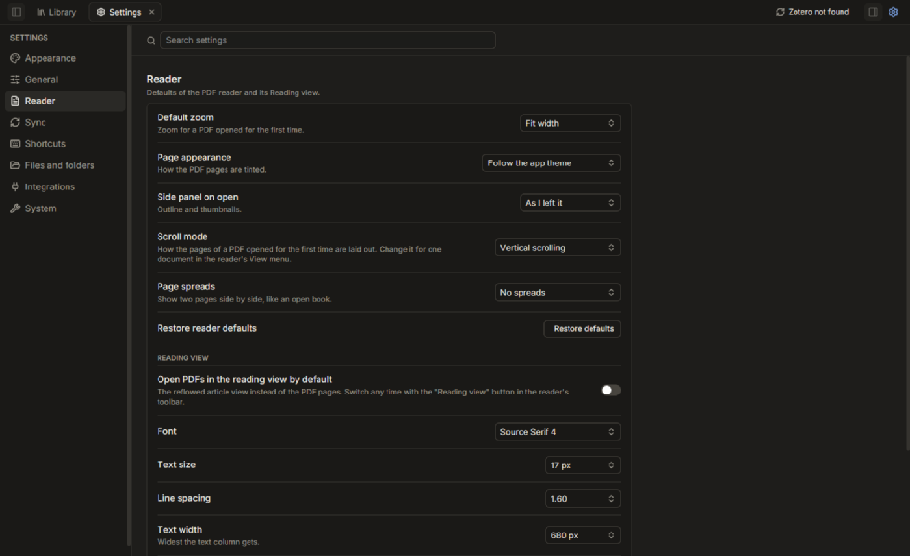

# Settings reference

Open Settings with **Ctrl+,** or the **Settings...** entry in the Tools menu (the wrench button in the toolbar). Settings opens as a tab with a section list on the left and a search box that finds individual settings by name or keyword.

Most changes apply as soon as you make them; there is no Save button except where a row has its own (the citation key formula, the Unpaywall email). Defaults below are what a fresh install uses.

Some rows exist but are marked as not available yet: **Update feeds automatically** (Files and folders), **Sync automatically** (Sync) and **LibreOffice and Google Docs** (Integrations).

Where settings are stored:

| Kind | Stored in |
| --- | --- |
| Window and interface choices (Appearance, the library layout, General, Reader, updates, the Locate address, the Plugins switches) | `ui-state.json` in the settings folder (see [Folders](first-run.md#folders)). **System** shows the exact path. |
| Plugins' own settings and data | the plugins folder (see [Plugins](plugins.md#where-plugins-live)) |
| Reading view typography | `reading-settings.json` next to `ui-state.json` |
| Quick Copy style | `cite-settings.json` next to the library database |
| Attachment storage and the Zotero data folder | `zotero-next.config.json` next to the library database |
| Better BibTeX | the library database (this computer only) |
| zotero.org API key | the operating system's secret store, never the library |

Sections are listed in the order they appear in the app.

## Appearance

Applied live.

| Setting | What it does | Default / options |
| --- | --- | --- |
| Theme | Light, dark, or follow the system. | Light, Dark, **System** |
| Colour scheme | The accent used for buttons, selection and focus rings, in light and dark. Button text colour is chosen automatically for at least 4.5:1 contrast. Choose Custom to type a `#rrggbb` colour. | **Quiet Paper**, Blue, Teal, Violet, Rose, Amber, Graphite, Custom |
| Interface font | The font for menus, lists and panels. Item titles keep their serif. Other lets you type the name of any installed font. | Manrope, System font, **Inter**, IBM Plex Sans, Source Sans 3, Other... |
| Text size | Base size of interface text. | 12 px, **13 px**, 14 px, 15 px |
| Reset appearance (button: **Reset**) | Back to System theme, Quiet Paper, Inter, 13 px. | |

### Sidebars

What the left sidebar and the item pane show, and in which order. See [Library basics](library.md). Each part is a row with a switch to show or hide it and up and down buttons to move it. The changes apply at once.

| Setting | What it does | Default / options |
| --- | --- | --- |
| Left sidebar | The groups of the left sidebar. Tags is always the last one: you can hide it, but not move it or move another group below it. | Library, Saved Searches, Collections, Group Libraries, Tags (all shown) |
| Item pane | The sections of the item pane on the right. The tabs under its header follow the same order, and a hidden section loses its tab. | Details, Abstract, Notes, Files, Collections, Tags, Related (all shown) |
| Reset sidebars (button: **Reset**) | Shows every group and section again, in the default order. | |

At least one part stays shown on each side. The last shown part cannot be hidden. Saved Searches is a group of its own. It shows whether or not Library is open. Group Libraries appears only when you belong to a group.

### Layout

How the library's panes are arranged. See [Layouts](layouts.md).

| Setting | What it does | Default / options |
| --- | --- | --- |
| Default layout | How the library is arranged. Choosing one arranges the library that way now (it can be undone); Reset layout returns to it. | **Standard** (sidebar, item list and item details side by side), Stacked (item details below the list), Triage (a wide list with Tags and Collections beside it) |
| Customize layout (button: **Customize...**) | Starts edit layout mode: every pane gets a header, so you can drag panes and item pane sections to another place, stack them as tabs or hide them. Press **Done** or Escape to finish. | |
| Reset layout (button: **Reset**) | Puts every pane back where the default layout has it. | |

## General

### Window

| Setting | What it does | Default / options |
| --- | --- | --- |
| Show the sidebar | Collections and tags on the left of the library. The top bar button toggles it too. | On |
| Show the item pane | Details of the selected item on the right of the library. | On |

### Item list

| Setting | What it does | Default / options |
| --- | --- | --- |
| Quick search mode | What the filter box above the item list searches. | **Title, Creator, Year**; All Fields & Tags; Everything (also notes and attachment full text) |
| Default view | Show items as cards or as a table. This is also the view the library opens in. | **Cards**, Table |
| Group by | Show items grouped in the item list. | No grouping, **Year**, Item type, First creator, Publication, Date added |
| Show unread dots | Show a small accent dot on items you have not opened yet. | On |

### Locate

| Setting | What it does | Default / options |
| --- | --- | --- |
| OpenURL resolver | Your library's OpenURL address. **Library Lookup** in an item's Locate menu opens it with the item's details. Empty disables Library Lookup. Must be an http or https address. | Empty |
| Locate engines | The search engines in an item's Locate menu, in this order. Each has a switch to enable it and buttons to move it up or down or remove it. Zotero's own list is only read, never changed. | A built-in list |
| Add a Locate engine (button: **Add engine from URL...**) | Adds an engine from the address of an OpenSearch description (an XML file a search site publishes). | |
| Import or reset engines (buttons: **Import from Zotero**, **Restore defaults**) | Import copies the engines from Zotero's data folder (`locate/engines.json`); a same-named engine is replaced. | |

See [Locate engines](locate-engines.md).

### Adding items

| Setting | What it does | Default / options |
| --- | --- | --- |
| Automatically attach associated PDFs when adding items | Find and attach available full-text PDFs when adding items by identifier or importing. | On |
| Automatically tag items with keywords and subject headings | Add tags from keywords and subject headings found in fetched metadata or imported files. | On |

## Reader

Defaults of the PDF reader, used when a document is opened for the first time. See [Reader](reader.md).

| Setting | What it does | Default / options |
| --- | --- | --- |
| Default zoom | Zoom for a PDF opened for the first time. | **Fit width**, Fit page, 50%, 75%, 100%, 125%, 150%, 200%, 300% |
| Page appearance | How the PDF pages are tinted. | **Follow the app theme** (dark pages in dark mode), Normal, Dark (inverted pages), Sepia |
| Side panel on open | Outline and thumbnails. | **As I left it**, Always open, Always closed |
| Scroll mode | How the pages are laid out. Change it for one document in the reader's View menu. | **Vertical scrolling**, Horizontal scrolling, Wrapped scrolling |
| Page spreads | Show two pages side by side, like an open book. | **No spreads**, Odd spreads (1-2, 3-4...), Even spreads (1 alone, then 2-3, 4-5...) |
| Restore reader defaults (button: **Restore defaults**) | Resets the five rows above. | |

### Reading view

The reflowed article view of a PDF (the **Reading view** button in the reader's toolbar). The font, size, spacing, width and theme can also be changed from the view's own panel.

| Setting | What it does | Default / options |
| --- | --- | --- |
| Open PDFs in the reading view by default | Open the reflowed view instead of the PDF pages. | Off |
| Font | Typeface of the reading text. | **Source Serif 4**, Literata, Georgia, Palatino Linotype, Cambria, Inter, System (the operating system's font), Verdana, or Other installed font… (type its name) |
| Text size | Size of the reading text. | 14, 16, **17**, 18, 20, 22, 24, 28 px (the view's panel allows 12 to 30) |
| Line spacing | Space between lines. | 1.30, 1.45, **1.60**, 1.80, 2.00 |
| Text width | Widest the text column gets. | 520, 600, **680**, 760, 880, 1000 px |
| Reading theme | Background of the reading view. | **Light**, Sepia, Dark (Custom colour, if you set one in the view's panel) |
| Restore reading view defaults (button: **Restore defaults**) | Resets font, size, spacing, width and theme (the open-by-default choice stays). | |

## Sync

How to use these is explained in [Sync](sync.md). Rows for the local Zotero source come first, then those for zotero.org.

| Setting | What it does | Default / options |
| --- | --- | --- |
| Zotero library | State of the Zotero data folder this library is kept in step with: status, when it was last read, changes waiting to write, conflicts, and a **Sync now** button. | |
| Write changes into Zotero | Off: Zotero's changes are still read in. On: edits made here are written to Zotero's database, only while Zotero is closed. Turning it on asks you to confirm you have a backup; a backup of `zotero.sqlite` is made before each write session. | Off |
| Zotero data folder | Shows the folder in use. Change it under Files and folders. | |
| Sync source | Where this library gets Zotero's changes from. Only one runs. | **Local Zotero**, zotero.org, Off |
| zotero.org account | Paste a zotero.org API key and click **Connect** (or **Replace key**); **Remove key** forgets it. The key is kept in the system's secret store, never in the library. | No key |
| Send changes to zotero.org | Off: zotero.org's changes are read in, nothing is sent. On: edits made here are uploaded. | Off |
| Attachment files | Whether the files of attachments follow along. Attachment metadata always syncs. | **Don't sync files**, Download only, Download and upload |
| zotero.org status | Last sync time, changes waiting to send, conflicts, any back-off or error, and a **Sync now** button. | |
| Online-only files | Attachment files that are on zotero.org but not on this computer. Buttons: **Check online-only files**, **Download missing files**. Check before removing files from zotero.org's storage. | |
| Sync automatically | Not available yet. | |

## Find Full Text

Settings for the Find Full Text command. See [Find Full Text](find-full-text.md). The same settings are in a dialog from **Find Full Text Settings...** in the Tools menu, which also has **Sign in to Institution...**.

| Setting | What it does | Default / options |
| --- | --- | --- |
| Institution | The library whose subscriptions are used to find PDFs. **Change...** opens a dialog with a search box for your institution, the OpenAthens domain, Shibboleth entityID, library proxy address, and how to sign in (Automatic, In a window here, Link for my own browser). **In a window here** is Windows only; on Linux and macOS the link opens in your own browser. | The built-in default institution |
| Use institutional access | Off: open-access sources only. | On |
| Unpaywall email | Sent to Unpaywall with each lookup, as their terms ask. Stays on your computer. Click **Save** to apply. | Empty |
| Items fetched at once | More is faster but harder on publisher sites. | 1 to 8; **4** |

## Cite

Quick Copy and citation style defaults. Changes save immediately. See [Citations and bibliographies](citations.md).

| Setting | What it does | Default / options |
| --- | --- | --- |
| Quick Copy style | Citation style for Copy Citation (Ctrl+Shift+A) and Copy Bibliography (Ctrl+Shift+C). **Browse all styles...** opens the full style picker. | **Vancouver**; other installed styles are listed |
| Language | Locale for citations. Empty uses the style's own. | **Style default**, English (US), English (UK), and others (Deutsch, Francais, Espanol, Italiano, Nederlands, Portugues (Brasil), Svenska, Polski, Russian, Chinese (Simplified), Japanese) |
| Quick Copy output | Preselected in the Create Bibliography dialog. | **Bibliography**, Citations |
| Quick Copy format | Preselected in the Create Bibliography dialog. | **HTML**, Plain text, Rich Text (RTF) |

## Better BibTeX

Citation keys, Better exports and automatic exports. See [Better BibTeX](better-bibtex.md).

| Setting | What it does | Default / options |
| --- | --- | --- |
| Citation key formula | Better BibTeX formula for generating keys. Separate alternatives with `\|` or `;`. Checked as you type, with a preview; **Save formula** is enabled for a valid, changed formula; **Revert** restores the saved one. | `auth.lower + shorttitle(3,3) + year` |
| Refresh all citation keys | Regenerate every key that is not pinned from the current formula. Tells you how many keys are out of date. | |
| Transliterate keys to ASCII | Fold accented letters, so Muller gives muller. | On |
| Keys differing only in case are duplicates | Treats keys that differ only by case as the same key. | On |
| Skip words | Comma-separated words the title functions leave out. | BBT's standard list |
| Duplicate postfix | Added to a key that already exists: `%(a)s` gives a, b, c...; `%(A)s` gives A, B, C...; `%(n)s` gives 1, 2, 3.... | `%(a)s` |
| Characters removed from keys | Characters stripped from every key. | `\"#%'(),={}~` |
| Better BibTeX: ASCII output | Write non-ASCII characters as LaTeX commands. | On |
| Better BibLaTeX: ASCII output | Off keeps Unicode characters. | Off |
| Protect capitalisation in titles | Wrap capitalised words in braces so BibTeX keeps their case. | On |
| DOI and URL | Which to keep when an item has both. | **Keep both**, DOI only, URL only |
| Export child notes | Include child notes in `.bib` exports. | Off |
| Export Extra as note | Add the item's Extra text as the `note` field. | Off |
| Copy citation key format | What **Copy Citation Key** puts on the clipboard. | **LaTeX \\cite** (`\cite{key}`), Pandoc (`[@key]`), Citation key (`@key`), BibLaTeX \\autocite, \\textcite, Org-mode (`[[cite:@key]]`), Typst (`@key`) |
| LaTeX cite command | For the LaTeX format: `cite` gives `\cite{key}`. | `cite` |
| Auto-export delay (seconds) | Wait this long after the last change before an on-change export rewrites its file. | 5 |
| Auto-export idle time (seconds) | Quiet time before a when-idle export rewrites its file. | 30 |
| Automatic exports | The list of automatic exports, each with **Export now** and **Remove**, and a form to add one: format, scope (Whole library or a collection), trigger (**On change** or **When idle**), file path, **Choose folder...**, **Add**. | None |

## Export

Defaults for the export dialog. See [Import and export](import-export.md).

| Setting | What it does | Default / options |
| --- | --- | --- |
| Default export format | Preselected in the Export Items and Export Collection dialogs. | **BibTeX**, BibLaTeX, RIS, CSL JSON, CSV, Zotero RDF, MODS, Better BibTeX, Better BibLaTeX, Better CSL JSON, Better CSL YAML |
| Include notes | Export notes together with the items by default. | Off |

## Shortcuts

Every command of the app with its keyboard shortcut, which you can change. This is Zotero's **Settings > Advanced > Shortcuts**, except that every command can have a shortcut here, not just eight, and changes apply at once (no restart).

- **Change**: press the new keys. A shortcut needs Ctrl or Alt with a key, or a function key (F1 to F12); plain letters, digits and arrows belong to the lists and text fields. Esc cancels. If another command already has those keys, they move to this one and you are told which command lost them.
- **Remove**: the command keeps no shortcut.
- **Reset to ...**: back to the default.
- **Reset all**: every command back to its default.

Under **Fixed keys** the page also lists the keys of the item list and the sidebar (arrows, Delete, 1–9, F2 ...), which cannot be changed. The defaults follow Zotero; see [Keyboard shortcuts](library.md#keyboard-shortcuts) for the full list. Your choices are stored in `ui-state.json` with the other window preferences.

## Files and folders

Where the library, Zotero's data and the attachments live. The storage rows are explained in [Attachment storage](zotmoov-storage.md).

| Setting | What it does | Default / options |
| --- | --- | --- |
| Library location | The database file your library is kept in, with its size. **Show in folder** opens it; **Change...** points Zinc at another library file, taking effect after a restart (the open library is left alone). The `ZN_DB` / `ZN_LIBRARY` environment variables win over this setting. | The default library file (see [Folders](first-run.md#folders)) unless you chose another |
| Zotero data folder | The Zotero library Zinc syncs with and imports from. **Find Zotero** looks in Zotero's settings and the usual places; **Browse...**, a path box, **Validate**, **Use this folder**, **Use automatic**, **Show in folder**. | Found automatically from Zotero's settings |
| Linked attachment base directory | Store linked file paths relative to a folder so they survive a move. Offers conversion of existing linked paths to relative ones and back, with a preview; only the database changes, no file is touched. | **Zotero's setting**, Choose folder..., None |
| Attachment storage location | Where imported files are kept: **Zinc's folder** or **Choose folder...**. With your own folder: subfolder pattern, linked files switch, **Move existing attachments to this folder...** and **Apply ZotMoov defaults**. May suggest a OneDrive `Zotero Library` folder. | Zinc's own folder |
| Place new files in the storage folder automatically | Files you add, save from the browser, import or fetch go straight to the storage folder. Off: only the Attachment Files commands use it. | On (once a folder is chosen) |
| Move or copy | Move: the file lives in the storage folder. Copy: it stays in the library's storage and a copy is also placed in the storage folder. | **Move**, Copy |
| File types to handle | Only these extensions go to the storage folder. Empty means every type. | Empty (the ZotMoov setup sets pdf, epub, docx, djvu) |
| Name files from their item | Names files `Author - Year - Title.ext`. A second switch makes the attachment title follow the file name. | Off; title follows name: On |
| Tag files in the storage folder | Tags attachments placed in the storage folder. | Off; tag `zotmoov` |
| Folder and file names | Strip diacritics; the text `%U` stands for in subfolder patterns. | Off; `undefined` |
| Delete files with their items | Delete the file when a linked attachment in the storage folder is deleted permanently. A second switch removes folders that become empty. | Off; empty folders removed: On |
| Attach newest file from | The folder (for example Downloads) used by **Attach Newest File**. Switch: ask for the file name first. | None; ask: Off |
| Update feeds automatically | Not available yet. | |

## Integrations

Word, and saving from your browser. Both are Windows only and are installed per user. On Linux and macOS, save from your browser with the official Zotero Connector (see [Adding items](adding-items.md#the-browser-connector)).

| Setting | What it does | Default / options |
| --- | --- | --- |
| Microsoft Word add-in | A Zinc sidebar in Word: search, insert citations and a bibliography (Zotero-compatible). Works without the app open. Buttons: **Install Microsoft Word add-in**, then **Reinstall** and **Uninstall**. Close Word first. See [Word add-in](word.md). | Installed if you kept the installer's Word component |
| LibreOffice and Google Docs | Cite-while-you-write for LibreOffice and Google Docs. Not available yet. | |
| Browser connector (Edge / Chrome) | Save papers and PDFs from Edge or Chrome into this library, even when the app is closed. **Install browser connector** installs the helper and opens the browser's extensions page; you then turn on Developer mode and choose Load unpacked yourself. Afterwards: **Add to Edge...** / **Add to Chrome...** and **Uninstall**. See [Adding items](adding-items.md). | |

## System

The core connection, saved interface state and about.

| Setting | What it does | Default / options |
| --- | --- | --- |
| Library core | The core API this window talks to, and whether it is reachable. Set `ZN_URL` (or `ZN_DB` for an in-process core) before starting the app to change it. | |
| Saved interface state | The file where panel sizes, theme and other window choices are kept, with **Show in folder**. | `ui-state.json` |
| Reset pane sizes (button: **Reset**) | Widths of the sidebar, item list and item pane. | |
| Reset the interface (button: **Reset...**) | Back to the default look and layout: panel sizes, theme, font, text size and Settings choices. Asks first. Your library is not touched. | |
| Runtime | The Bun version and platform the window runs on. | |

### Updates

Settings under System > Updates. See [Updates](updates.md). Updating in the app is Windows only; on Linux and macOS you download a newer release by hand and the updater does not start.

| Setting | What it does | Default / options |
| --- | --- | --- |
| Version | The version and build of this Zinc. | |
| Check for updates | Status of the last check, with **Check now**, and when an update is found **What's new**, **Install on exit** and **Install now**. Updates are signed; a download that does not match its signature, size and checksum is never run. | |
| Check automatically | Look for a new version when Zinc starts and once a day. When off, nothing is requested from the internet unless you press Check now. | On |
| Download automatically | Fetch the installer in the background as soon as a new version is found. It is installed only when you choose Install now or Install on exit. | Off |
| Update feed | The https address of the signed `latest.json`. Empty uses the address built into this version, if any. | Empty |

## Plugins

Plugins are experimental and off by default. See [Plugins](plugins.md).

| Setting | What it does | Default / options |
| --- | --- | --- |
| Enable plugins (experimental) | Runs installed plugins in a separate process. Takes effect the next time Zinc starts. | Off |
| Install a plugin (button: **Install from file...**) | Installs or updates a plugin from a `.zplugin` file, after showing the permissions it asks for. Available while plugins are running. | |
| *each plugin* | Its name, version and status (running, off, failed, ...), a switch to turn it on or off, and **Remove** (asks first; deletes the plugin with its settings and data). **Review permissions...** appears when an update waits for your approval. | On after install |
| Offer *plugin*'s tools to AI agents | Shown under a plugin that asks to offer tools to AI agents. Lets agents connected to Zinc's MCP server (HTTP, while Zinc runs) call the plugin's tools, with the number it declares. They can do whatever the plugin is allowed to do. See [MCP for AI agents](mcp.md#tools-from-plugins). | Off |

A plugin with a settings pane of its own appears as its own section after Plugins.
